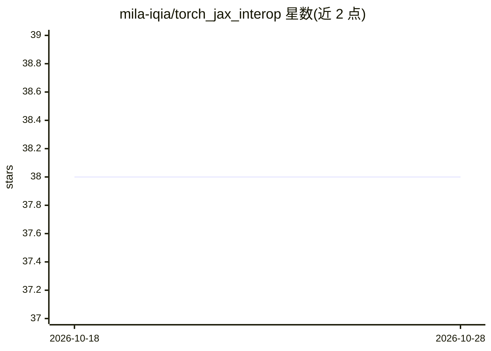

# mila-iqia/torch_jax_interop

⭐ 38 · Python · MIT · 推送 2026-01-08 · [GitHub](https://github.com/mila-iqia/torch_jax_interop) · [官网](https://lebrice.github.io/torch_jax_interop/) · 组织维护

**PyTorch 与 JAX 张量互转与函数互包装工具库**

提供 torch_to_jax、jax_to_torch、WrappedJaxFunction、torch_module_to_jax 四个工具，基于 dlpack 格式在 PyTorch Tensor 与 JAX 数组间转换，支持零拷贝共享（部分内存布局如 channels-first 需 flatten/unflatten 并可能拷贝）。可将 JAX/Flax 函数包装为带可学习参数的 torch.nn.Module，也可将 torch 模块转为可 jax.jit 的函数，用于渐进引入 Jax 而不重写现有 PyTorch 代码。通过 pip 或 uv 安装，默认仅装 CPU 版 Jax，GPU 版需额外安装。面向深度学习开发者。

## 筛选速览

| 维度 | 判定 | 备注 |
|---|---|---|
| AI 角色 | `ai-ecosystem` | LLM/agent 周边工具 |
| 许可风险 | `permissive` | MIT |
| 部署形态 | `library` | 以包/库形式分发 |
| 模型依赖 | — | README 未给出锁定关系 |
| 硬件要求 | — | 无带数字的原话,不猜 |
| 安装摩擦 | `medium` | 含编译或系统依赖之一 |
| 成熟度 | — | 结构信号不足 |

## 能力要点

- dlpack 实现的 PyTorch/JAX 张量互转（部分布局零拷贝）
- JAX/Flax 函数可包装为带可学习参数的 torch.nn.Module
- torch.nn.Module 可转为支持 jax.jit 的 Jax 函数

## 适用场景

- 在现有 PyTorch 代码库中渐进引入 Jax 的 jit 与自动微分
- 避免将模型在 PyTorch 与 Jax 间完整重写
- 在 Lightning 等 PyTorch 框架中使用 Jax/Flax 模块

## 场景标签

 · 领域:深度学习框架工具

## 证据(README 行号)

> L14: This package contains a few utility functions to simplify interoperability between jax and torch: `torch_to_jax`, `
> L16: This repository contains utilities for converting PyTorch Tensors to JAX arrays and vice versa.
> L17: This conversion happens thanks the `dlpack` format, which is a common format for exchanging tensors between differe

## 星数曲线

2026-10-18 38 → 2026-10-28 38（+0）

---
*卡片 v1 · prompt 1.4 · 生成 2026-10-25 · 置信度 high · 依据 README sha `3ff1ca4af20f` · [字段定义](../../DATASET.md)*
