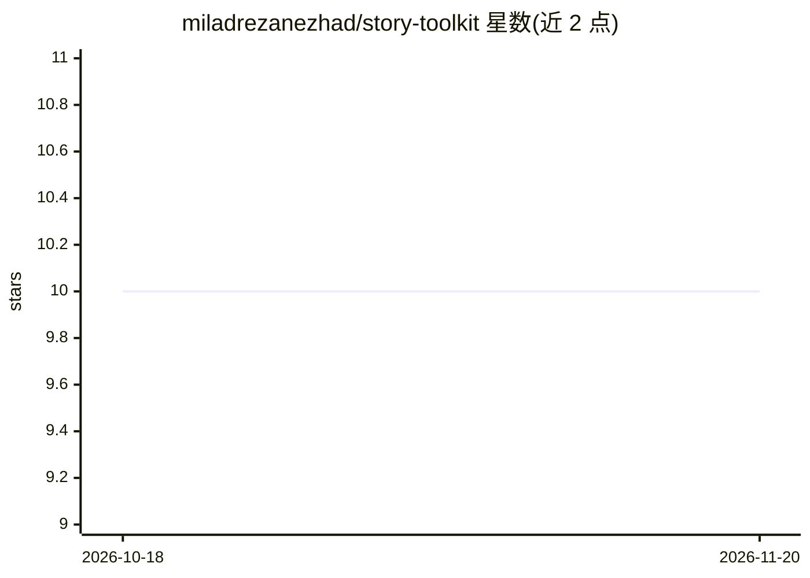

# miladrezanezhad/story-toolkit

⭐ 10 · Python · MIT · 推送 2026-10-20 · [GitHub](https://github.com/miladrezanezhad/story-toolkit) · [官网](https://miladrezanezhad.github.io/story-toolkit/) · 个人维护

**面向作者与开发者的故事创作 Python 工具包，可选接入 LLM**

提供角色创建、情节生成、对话编写、世界观构建与故事连贯性检查的 Python 工具包，附带 CLI 与五种预设结构模板（英雄之旅、三幕等）。核心功能基于模板与 NLP 库（nltk/spacy/textblob），无需 LLM 即可运行；LLM 为可选层，通过 extras 接入 OpenAI、Anthropic 或本地 Ollama。支持 SQLite 长期记忆、PDF/EPUB/HTML/JSON/Markdown 导出，v2.2.3 加入 76 项安全测试与 XSS、SQL 注入等防护。

## 筛选速览

| 维度 | 判定 | 备注 |
|---|---|---|
| AI 角色 | `ai-enhanced` | 去掉 AI 部分产品仍成立 |
| 许可风险 | `permissive` | MIT |
| 部署形态 | `library` | 以包/库形式分发 |
| 模型依赖 | local-ok | 支持本地模型 |
| 硬件要求 | — | 无带数字的原话,不猜 |
| 安装摩擦 | `low` | 无编译、无系统依赖或容器化 |
| 成熟度 | — | 结构信号不足 |

## 能力要点

- 角色/情节/对话/世界观生成与连贯性检查一体化
- 无 LLM 也可运行，LLM 为可选后端（OpenAI/Anthropic/Ollama）
- PDF/EPUB/HTML/JSON/Markdown 多格式导出
- 提供 CLI 命令行工具与五种预设故事模板

## 适用场景

- 为小说创作构建角色档案与世界观设定
- 按英雄之旅等模板生成故事结构
- 检查情节漏洞与角色前后不一致
- 将故事导出为 PDF/EPUB 电子书格式

## 场景标签

`AI 写作` · 领域:内容生成

## 证据(README 行号)

> L17: **A comprehensive Python toolkit for generating engaging and coherent stories with optional LLM support.**
> L39: |🤖 **LLM Support**|Optional integration with OpenAI, Anthropic, and local models|
> L49: # Basic installation (no LLM)

## 星数曲线

2026-10-18 10 → 2026-11-20 10（+0）

---
*卡片 v1 · prompt 1.4 · 生成 2026-11-19 · 置信度 high · 依据 README sha `7c51ad0a4bb1` · [字段定义](../../DATASET.md)*
