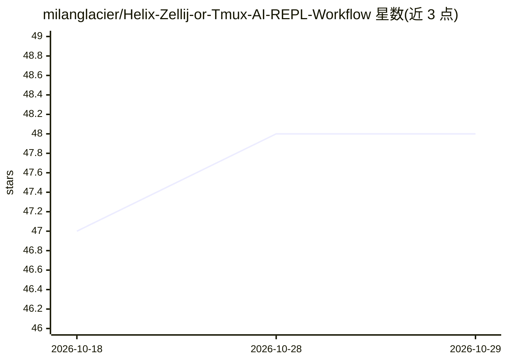

# milanglacier/Helix-Zellij-or-Tmux-AI-REPL-Workflow

⭐ 48 · Shell · GPL-3.0 · 推送 2026-03-26 · [GitHub](https://github.com/milanglacier/Helix-Zellij-or-Tmux-AI-REPL-Workflow) · 个人维护

**Helix+Zellij/Tmux 的 AI 补全与 REPL 工作流脚本集**

由五个 shell 脚本组成的编辑器工作流集成：haico 调用 OpenAI/Gemini/Codestral/Claude API 为 Helix 生成代码补全，仅依赖 jq 与标准 Unix 工具；qantara 检测 Zellij 或 Tmux 并转发到对应后端 zqantara/tqantara，以 bracketed paste 向 REPL 及 AI CLI（Aider、Claude Code）发送内容；symbol-search 提供 ctags/ripgrep/grep 多后端的工作区符号补全，可选 fzf，缺失时回退到内置 picker。面向使用 Helix 的键盘驱动开发者，安装方式为克隆仓库并将 bin/ 下脚本复制到 PATH。

## 筛选速览

| 维度 | 判定 | 备注 |
|---|---|---|
| AI 角色 | `ai-ecosystem` | LLM/agent 周边工具 |
| 许可风险 | `viral` | GPL-3.0 |
| 部署形态 | `None` |  |
| 模型依赖 | locked-api |  |
| 硬件要求 | — | 无带数字的原话,不猜 |
| 安装摩擦 | `low` | 无编译、无系统依赖或容器化 |
| 成熟度 | — | 结构信号不足 |

## 能力要点

- haico 多提供商 AI 补全（OpenAI/Gemini/Codestral/Claude/FIM），仅依赖 jq
- qantara 自动路由 Zellij/Tmux 后端，一套 Helix 键位双环境通用
- bracketed paste 模式保证多行内容完整发送到 REPL
- symbol-search 支持 ctags/ripgrep/grep 回退链，零强制外部依赖

## 适用场景

- 在 Helix 中用多家 API 获得代码补全
- 用同一套键位把代码发送到 Zellij/Tmux 中的 REPL 执行
- 在多路复用器会话中管理 Aider、Claude Code 等 AI CLI 工具
- 工作区范围内的符号补全

## 场景标签

`代码生成` · 领域:编码与开发

## 证据(README 行号)

> L10: - **`haico`** - AI-powered code completion for Helix editor supporting OpenAI,
> L3: This repository provides a complete workflow integration for modern development
> L22: - Code editing in Helix with AI-powered completions

## 星数曲线

2026-10-18 47 → 2026-10-29 48（+1）

---
*卡片 v1 · prompt 1.4 · 生成 2026-10-25 · 置信度 high · 依据 README sha `8e104caca47d` · [字段定义](../../DATASET.md)*
