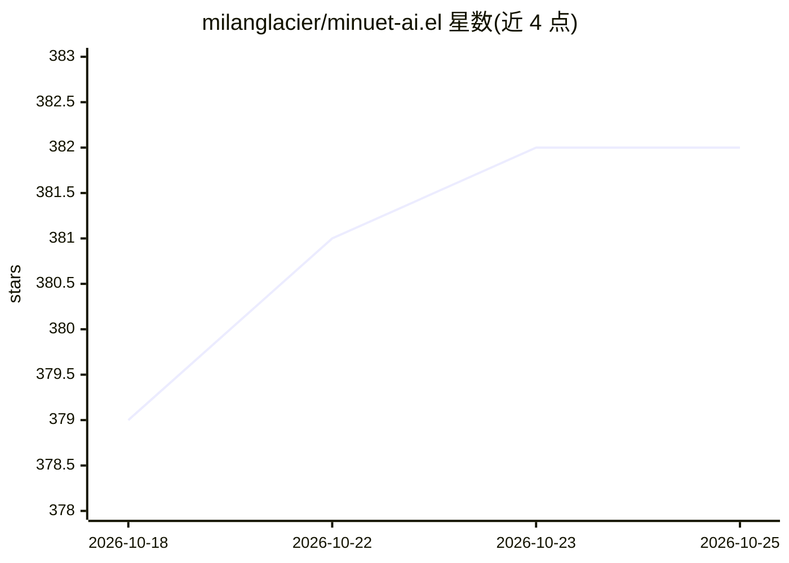

# milanglacier/minuet-ai.el

⭐ 382 · Emacs Lisp · GPL-3.0 · 推送 2026-10-09 · [GitHub](https://github.com/milanglacier/minuet-ai.el) · 个人维护

**Emacs 的 LLM 代码补全插件：边打字边从多家模型取建议**

运行于 Emacs 29+ 的代码补全包，把光标前后上下文发给 LLM，以 minibuffer 或 overlay 幽灵文本两种前端展示补全，支持逐行采纳多行建议、流式传输、防抖节流与建议与已输入文本的同步保留。接入 OpenAI、Claude、Gemini、Codestral、Ollama、Llama.cpp 及 OpenAI 兼容端点，chat 模型与 FIM 模型各用一套提示系统；另含实验性的下一处编辑预测（minuet-duet）。需至少一家提供商的 API key，通过 ELPA/MELPA 安装。

## 筛选速览

| 维度 | 判定 | 备注 |
|---|---|---|
| AI 角色 | `ai-native` | 本体是模型或模型工具 |
| 许可风险 | `viral` | GPL-3.0 |
| 部署形态 | `None` |  |
| 模型依赖 | local-ok | 支持本地模型 |
| 硬件要求 | — | 无带数字的原话,不猜 |
| 安装摩擦 | `low` | 无编译、无系统依赖或容器化 |
| 成熟度 | `idea` | |

## 能力要点

- 双模式补全：chat 模型专用提示与 FIM（DeepSeek/Codestral/部分 Ollama 模型）
- 支持 OpenAI、Claude、Gemini、Codestral、Ollama、Llama.cpp 与 OpenAI 兼容端点
- 流式传输 + 逐行采纳多行建议，输入匹配时保留补全以减少请求
- 实验性下一处编辑预测（minuet-duet，含自动预测模式）

## 适用场景

- 在 Emacs 中获得多家云端或本地 LLM 的行内代码补全
- 用 Ollama/llama.cpp 本地模型做离线代码补全
- 对补全的触发时机、上下文窗口与请求并发做细粒度配置

## 场景标签

`代码生成` · 领域:编码与开发

## 证据(README 行号)

> L15: - LLM-powered code completion with dual modes:
> L20: - Support for multiple LLM providers (OpenAI, Claude, Gemini, Codestral, Ollama,

## 星数曲线

2026-10-18 379 → 2026-10-25 382（+3）

---
*卡片 v1 · prompt 1.4 · 生成 2026-10-21 · 置信度 high · 依据 README sha `f37f442116db` · [字段定义](../../DATASET.md)*
