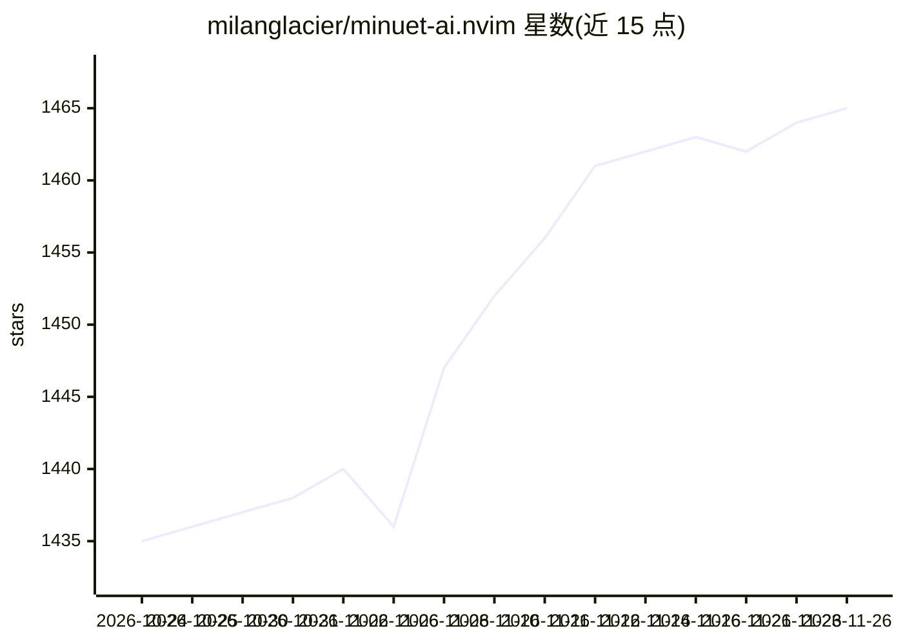

# milanglacier/minuet-ai.nvim

⭐ 1,465 · Lua · GPL-3.0 · 推送 2026-11-23 · [GitHub](https://github.com/milanglacier/minuet-ai.nvim) · 个人维护

**Neovim 的 LLM 代码补全插件：接入多家模型边写边补全**

面向 Neovim 用户的 AI 代码补全插件，支持两种补全模式：面向聊天类 LLM 的专用提示词补全，以及面向 DeepSeek、Codestral、Qwen 等模型的 FIM（fill-in-the-middle）补全。接入 OpenAI、Claude、Gemini、Codestral、Ollama、Llama.cpp 及 OpenAI 兼容服务，支持流式输出、多行建议逐行接受、输入同步以减少请求。提供 virtual-text、nvim-cmp、blink-cmp、内置补全、mini.completion 五种前端，并可以进程内 LSP 形式提供补全（需 Neovim 0.11+）。通过 Lazy.nvim 或 luarocks 安装，需 Neovim 0.10+ 且至少一个服务商的 API key。

## 筛选速览

| 维度 | 判定 | 备注 |
|---|---|---|
| AI 角色 | `ai-native` | 本体是模型或模型工具 |
| 许可风险 | `viral` | GPL-3.0 |
| 部署形态 | `library` | 以包/库形式分发 |
| 模型依赖 | local-ok | 支持本地模型 |
| 硬件要求 | — | 无带数字的原话,不猜 |
| 安装摩擦 | `low` | 无编译、无系统依赖或容器化 |
| 成熟度 | — | 结构信号不足 |

## 能力要点

- 双模式补全：聊天类 LLM 专用提示词与 FIM 补全
- 支持 OpenAI、Claude、Gemini、Codestral、Ollama、Llama.cpp 等 provider
- 五种补全前端，含 virtual-text 与进程内 LSP（opt-in）
- 流式输出与逐行接受多行建议

## 适用场景

- 在 Neovim 中获得边输入边出现的 AI 代码补全
- 用 Ollama 或 llama.cpp 在本地跑补全模型
- 通过 OpenAI 兼容接口接入自定义或低成本服务商

## 场景标签

`代码生成` · 领域:编码与开发

## 证据(README 行号)

> L12: - AI-powered code completion with dual modes:
> L16: - Support for multiple AI providers (OpenAI, Claude, Gemini, Codestral, Ollama,
> L19: - Streaming support to enable completion delivery even with slower LLMs.

## 星数曲线

2026-10-24 1,435 → 2026-11-26 1,465（+30）

---
*卡片 v1 · prompt 1.4 · 生成 2026-11-24 · 置信度 mid · 依据 README sha `41a339984c68` · [字段定义](../../DATASET.md)*
