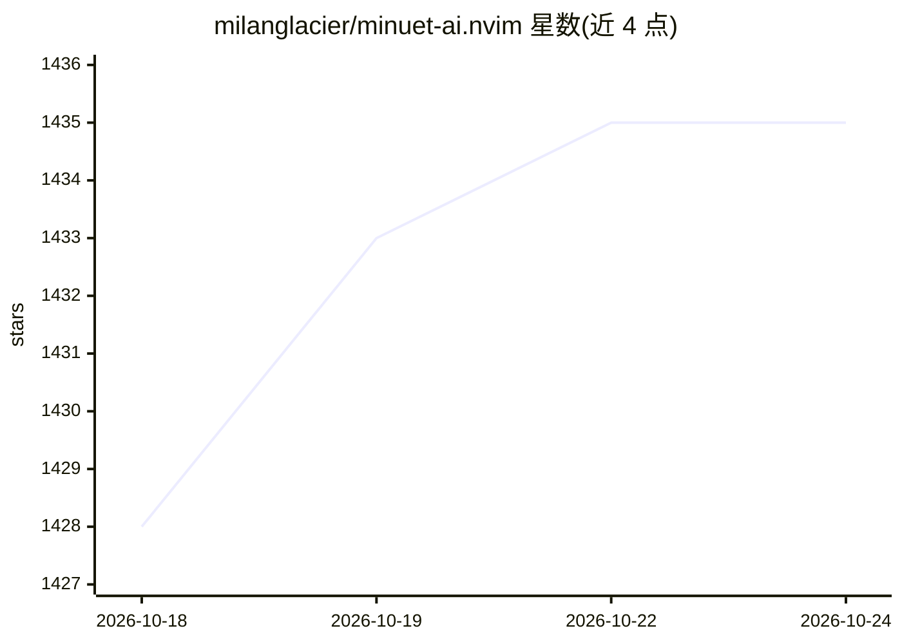

# milanglacier/minuet-ai.nvim

⭐ 1,436 · Lua · GPL-3.0 · 推送 2026-10-07 · [GitHub](https://github.com/milanglacier/minuet-ai.nvim) · 个人维护

**Neovim 插件：边打字边从多种 LLM 获取代码补全**

面向 Neovim 用户的 AI 代码补全插件，通过请求 OpenAI、Claude、Gemini、Codestral、Ollama、Llama.cpp 及 OpenAI 兼容服务等提供商，在输入时流式提供补全。支持 chat 模型与 FIM（DeepSeek、Codestral、Qwen 等）双模式，提供 virtual-text、nvim-cmp、blink-cmp、内建补全及进程内 LSP 等多种前端，可逐行采纳多行建议并随输入同步保持建议。需要至少一个提供商的 API key，本地 Ollama 也需占位环境变量。

## 筛选速览

| 维度 | 判定 | 备注 |
|---|---|---|
| AI 角色 | `ai-ecosystem` | LLM/agent 周边工具 |
| 许可风险 | `viral` | GPL-3.0 |
| 部署形态 | `library` | 以包/库形式分发 |
| 模型依赖 | local-ok | 支持本地模型 |
| 硬件要求 | — | 无带数字的原话,不猜 |
| 安装摩擦 | `low` | 无编译、无系统依赖或容器化 |
| 成熟度 | — | 结构信号不足 |

## 能力要点

- chat 与 FIM 双补全模式，支持流式输出
- virtual-text/nvim-cmp/blink-cmp/内建补全/进程内 LSP 多前端
- 多行建议可逐行增量采纳，输入同步减少重复请求
- 支持 NES 下一编辑预测（标注为高度实验性）

## 适用场景

- 在 Neovim 中边打字边获得 LLM 代码补全
- 用本地 Ollama 或 llama.cpp 做离线补全
- 按语言选择启用自动或手动补全触发

## 场景标签

`代码生成` · 领域:编码与开发

## 证据(README 行号)

> L12: - AI-powered code completion with dual modes:
> L16: - Support for multiple AI providers (OpenAI, Claude, Gemini, Codestral, Ollama,
> L20: - No proprietary binary running in the background. Just curl and your preferred LLM provider.

## 星数曲线

2026-10-18 1,428 → 2026-10-24 1,435（+7）

---
*卡片 v1 · prompt 1.4 · 生成 2026-10-21 · 置信度 mid · 依据 README sha `c4a1dd63ca7b` · [字段定义](../../DATASET.md)*
