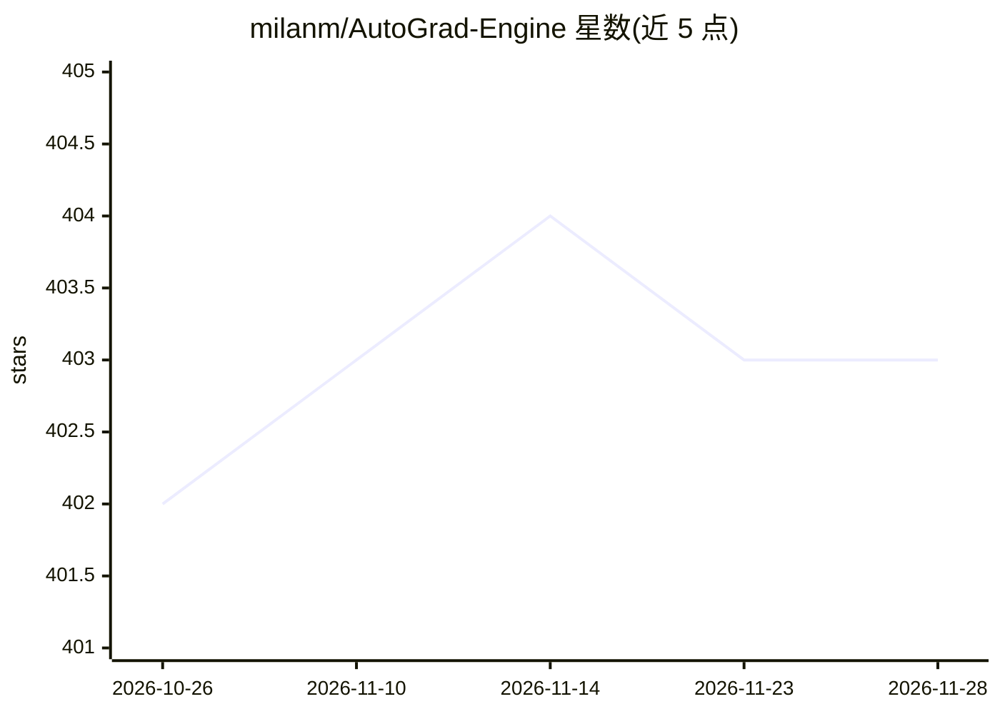

# milanm/AutoGrad-Engine

⭐ 403 · C# · MIT · 推送 2026-10-24 · [GitHub](https://github.com/milanm/AutoGrad-Engine) · 个人维护

**约600行纯 C# 实现的 GPT 训练与推理教学项目**

Karpathy microgpt.py 的 C# 移植：在 4 个文件约 600 行代码内实现完整 GPT 的训练与推理，包含 autograd 引擎、字符级分词器、Transformer 组件（RMSNorm、多头注意力、KV cache）与 Adam 优化器。在约 3.2 万个人名数据上训练，随后自回归生成新名字。零第三方依赖，仅用 .NET 运行。README 附带从零讲解全部数学概念的前置指南与 25 个数值梯度检查测试。作者明确声明非生产代码，逐标量运算、在 CPU 上以分钟级时间训练。

## 筛选速览

| 维度 | 判定 | 备注 |
|---|---|---|
| AI 角色 | `ai-native` | 本体是模型或模型工具 |
| 许可风险 | `permissive` | MIT |
| 部署形态 | `None` |  |
| 模型依赖 | — | README 未给出锁定关系 |
| 硬件要求 | — | 无带数字的原话,不猜 |
| 安装摩擦 | `medium` | 含编译或系统依赖之一 |
| 成熟度 | — | 结构信号不足 |

## 能力要点

- 约 600 行 C#、4 个文件实现 GPT 训练与推理，零第三方依赖
- 内置 autograd 引擎，通过 25 个数值梯度检查测试验证
- 支持 CLI 参数调整模型规模、训练步数、学习率与随机种子
- 附从零讲解分词、嵌入、注意力、反向传播的教学文档

## 适用场景

- 学习 GPT 与反向传播的内部实现原理
- 阅读带有逐行注释的模型代码作为 ML 入门教材
- 在笔记本 CPU 上跑通一次完整的模型训练与文本生成流程

## 场景标签

`模型训练` `教程课程` · 领域:学习与行业

## 证据(README 行号)

> L9: A complete GPT language model (training and inference) in pure C# with zero dependencies.
> L17: It trains a tiny GPT model on a list of human names, then generates new ones that sound real but never existed.
> L30: |`Program.cs`|GPT model, training loop (`Train`), and generation (`Generate`)|

## 星数曲线

2026-10-26 402 → 2026-11-28 403（+1）

---
*卡片 v1 · prompt 1.4 · 生成 2026-11-25 · 置信度 high · 依据 README sha `8a620bb11981` · [字段定义](../../DATASET.md)*
