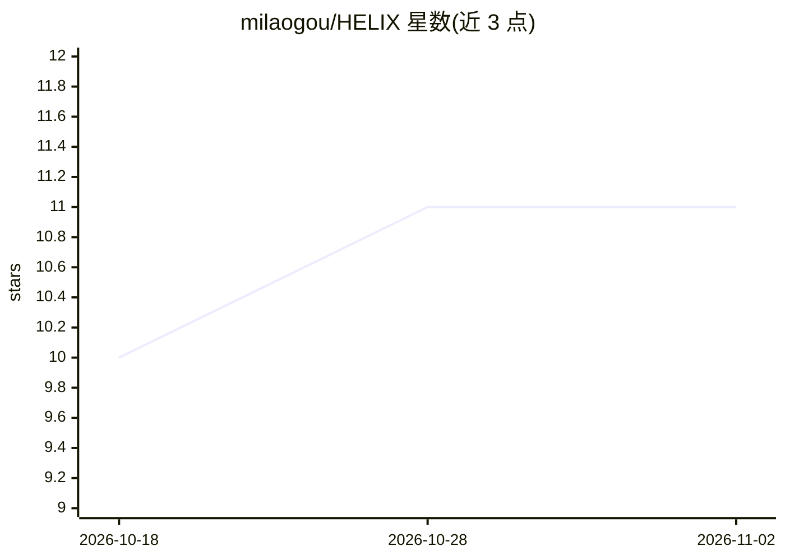

# milaogou/HELIX

⭐ 11 · Python · BSD-3-Clause · 推送 2026-05-05 · [GitHub](https://github.com/milaogou/HELIX) · [官网](https://arxiv.org/abs/2605.02278) · 组织维护

**面向科研者的时间序列缺失值填补模型 HELIX 官方实验代码**

ICML 2026 Spotlight 论文 HELIX 的官方实验代码库：提出可学习特征身份嵌入（FeatID）、正弦位置编码与身份嵌入结合的混合编码，以及跨时间-特征维度的融合机制，用于多变量不完整时间序列的填补。模型已并入 PyPOTS 主分支（v1.5 发布），可通过 pip 安装使用；本仓库另提供基准实验脚本与消融变体。实验在 Linux aarch64 集群与 NVIDIA A100 GPU 上经 SLURM 提交完成，脚本需按自有环境调整。

## 筛选速览

| 维度 | 判定 | 备注 |
|---|---|---|
| AI 角色 | `ai-native` | 本体是模型或模型工具 |
| 许可风险 | `permissive` | BSD-3-Clause |
| 部署形态 | `library` | 以包/库形式分发 |
| 模型依赖 | — | README 未给出锁定关系 |
| 硬件要求 | — | 无带数字的原话,不猜 |
| 安装摩擦 | `low` | 无编译、无系统依赖或容器化 |
| 成熟度 | — | 结构信号不足 |

## 能力要点

- FeatID 可学习特征身份嵌入区分异构变量
- 混合编码同时捕捉时间位置与特征特性
- 跨维度融合机制支持时间/特征双向信息流
- 提供消融变体与门控融合变体

## 适用场景

- 多变量不完整时间序列的缺失值填补
- 复现论文基准实验或与基线方法对比
- 通过 PyPOTS 工具箱直接调用 HELIX 模型

## 场景标签

 · 领域:时间序列/数据填补

## 证据(README 行号)

> L16: The official experiment code for the paper
> L29: ⦿ **`Motivation`**: Existing time series imputation methods often treat temporal and feature dimensions in isolatio
> L39: - **Cross-dimensional Synthesis**: A fusion mechanism that synthesizes information across the temporal and feature

## 星数曲线

2026-10-18 10 → 2026-11-02 11（+1）

---
*卡片 v1 · prompt 1.4 · 生成 2026-11-02 · 置信度 high · 依据 README sha `e37a5eaa68e2` · [字段定义](../../DATASET.md)*
