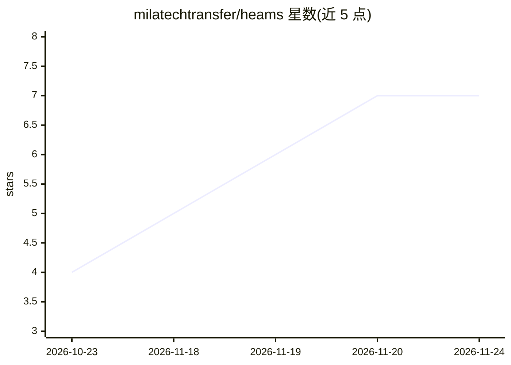

# milatechtransfer/heams

⭐ 7 · Python · Apache-2.0 · 推送 2026-11-20 · [GitHub](https://github.com/milatechtransfer/heams) · [官网](https://milatechtransfer.github.io/heams/) · 组织维护

**面向 AI agent 记忆系统的开源评测框架**

HEAMS 通过五类基准（性能、隐私、安全、用户主权、效率）评测 agent 记忆系统，各维度以独立指标并列报告而非合并为单一分数。记忆系统经统一接口接入框架，agent、记忆系统与基准均以 YAML 声明，通过在运行配置中列举实验来比较不同记忆系统。内置 in_context 与 no_memory 基线及多个插件（mem0、hipporag、letta 等），并支持以隐私包装插件为任意记忆系统添加留存与召回策略。

## 筛选速览

| 维度 | 判定 | 备注 |
|---|---|---|
| AI 角色 | `ai-ecosystem` | LLM/agent 周边工具 |
| 许可风险 | `permissive` | Apache-2.0 |
| 部署形态 | `None` |  |
| 模型依赖 | — | README 未给出锁定关系 |
| 硬件要求 | — | 无带数字的原话,不猜 |
| 安装摩擦 | `low` | 无编译、无系统依赖或容器化 |
| 成熟度 | — | 结构信号不足 |

## 能力要点

- 覆盖性能、隐私、安全、用户主权、效率五个维度的基准集
- 各维度指标并列报告，不合并为单一分数
- agent、记忆系统与基准以 YAML 声明，配置式扩展实验
- 内置基线与 mem0、HippoRAG 2、Letta 等记忆系统插件，附隐私策略包装插件

## 适用场景

- 在自己的记忆系统上运行同一套评测并与基线对比
- 评估记忆系统在受污染记忆、信息越权共享等场景下的表现
- 测量记忆系统的 token、成本、延迟与存储开销

## 场景标签

`Agent 记忆` `模型评测` · 领域:Agent 开发

## 证据(README 行号)

> L12: HEAMS is an open framework for evaluating memory systems for AI agents
> L24: rather than collapsed into a single score, so trade-offs stay visible. Memory
> L26: Agents, memory systems, and benchmarks are declared in YAML, so

## 星数曲线

2026-10-23 4 → 2026-11-24 7（+3）

---
*卡片 v1 · prompt 1.4 · 生成 2026-11-20 · 置信度 high · 依据 README sha `0856814961d9` · [字段定义](../../DATASET.md)*
