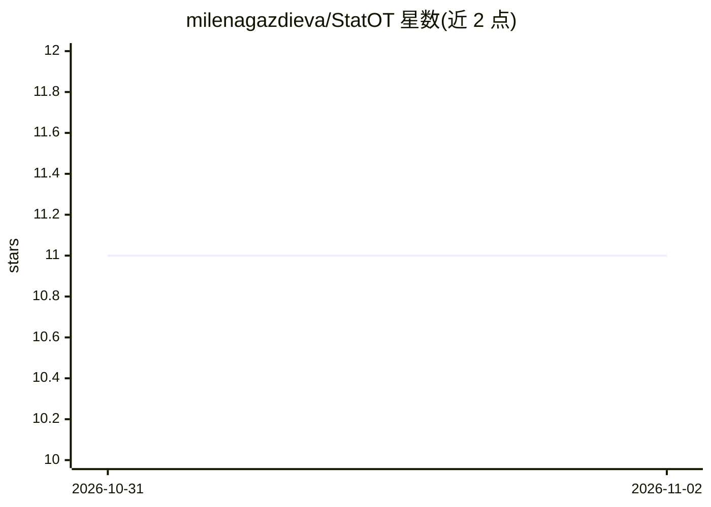

# milenagazdieva/StatOT

⭐ 11 · Python · MIT · 推送 2026-07-13 · [GitHub](https://github.com/milenagazdieva/StatOT) · [官网](https://iclr.cc/virtual/2026/poster/10010612) · 个人维护

**ICLR 2026 神经最优传输求解器泛化误差实验的 PyTorch 实现**

论文《A Statistical Learning Perspective on Semi-dual Adversarial Neural Optimal Transport Solvers》（ICLR 2026）的官方 Python/PyTorch 实现，用于复现实验：验证半对偶对抗神经 OT 求解器的经验泛化误差接近理论界（Corollary 4.10）。实验分两 regime：估计误差（受训练样本量影响）与逼近误差（受网络表达能力影响），分别由 train_stat.py 与 train_approx.py 运行。实现基于 GPU，在 torch 2.0.0+cu117 与 1 块 Tesla V100 上测试；README 未给出安装命令，面向论文复现的科研用户。

## 筛选速览

| 维度 | 判定 | 备注 |
|---|---|---|
| AI 角色 | `ai-native` | 本体是模型或模型工具 |
| 许可风险 | `permissive` | MIT |
| 部署形态 | `None` |  |
| 模型依赖 | — | README 未给出锁定关系 |
| 硬件要求 | — | 无带数字的原话,不猜 |
| 安装摩擦 | `medium` | 含编译或系统依赖之一 |
| 成熟度 | — | 结构信号不足 |

## 能力要点

- 论文官方 PyTorch 复现代码（ICLR 2026）
- 两类实验：估计误差（train_stat.py）与逼近误差（train_approx.py）
- 复用 Wasserstein-2 Benchmark 代码做测试
- 实验结果与理论界 Corollary 4.10 对照

## 适用场景

- 复现论文中神经 OT 求解器泛化误差实验
- 研究样本量与网络容量对 OT 求解器泛化的影响
- 在 Wasserstein-2 Benchmark 上测试方法

## 场景标签

`科研工具` · 领域:学习与行业

## 证据(README 行号)

> L2: This is the official `Python` implementation of the ICLR 2026 paper **A Statistical Learning Perspective on Semi-dua
> L4: This repository contains reproducible PyTorch code for experiments demonstrating that the empirically observed gener

## 星数曲线

2026-10-31 11 → 2026-11-02 11（+0）

---
*卡片 v1 · prompt 1.4 · 生成 2026-11-02 · 置信度 high · 依据 README sha `f290fa798f57` · [字段定义](../../DATASET.md)*
