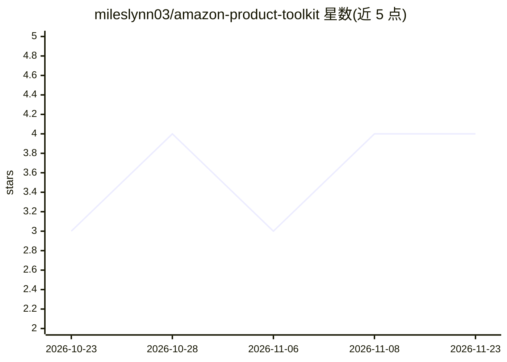

# mileslynn03/amazon-product-toolkit

⭐ 4 · Python · MIT · 推送 2026-10-22 · [GitHub](https://github.com/mileslynn03/amazon-product-toolkit) · 个人维护 · 中文 README

**带本地网页界面的亚马逊评论抓取与翻译导出工具**

以本地 Web UI 运行的亚马逊评论采集子项目：用户登录自己的亚马逊账号完成验证后，按 ASIN × 市场 × 星级组合翻页采集评论，支持快速扫描与深度采集两种模式、区域过滤、逐页保存与断点重试、去重与停止原因记录。可选接入 OpenAI-compatible Chat Completions 或原生 Anthropic Messages 协议做翻译，导出含原文与译文并列的 Excel。中文/英文界面，源码分发，首次运行自动安装依赖与 Playwright Chromium，无独立 EXE/APP。任务完成不保证覆盖全部评论，二十个市场尚未逐一完成实测验收。

## 筛选速览

| 维度 | 判定 | 备注 |
|---|---|---|
| AI 角色 | `ai-enhanced` | 去掉 AI 部分产品仍成立 |
| 许可风险 | `permissive` | MIT |
| 部署形态 | `None` |  |
| 模型依赖 | — | README 未给出锁定关系 |
| 硬件要求 | — | 无带数字的原话,不猜 |
| 安装摩擦 | `low` | 无编译、无系统依赖或容器化 |
| 成熟度 | — | 结构信号不足 |

## 能力要点

- 登录自有账号的分页深度采集，支持批量 ASIN 与市场/星级复选过滤
- 逐页保存与重试：失败或停止任务保留已有结果且不重复合并
- 可选 LLM 翻译：OpenAI-compatible 与 Anthropic 原生协议，原文译文并列导出
- 中文/英文界面切换与应用内 ? 指南

## 适用场景

- 批量采集多个 ASIN 的亚马逊评论并导出 Excel 分析
- 将外文评论翻译为中文后与原文对照阅读
- 按市场与星级筛选评论样本做主题研究

## 场景标签

`网页抓取` · 领域:效率与自动化

## 证据(README 行号)

> L9: **An open-source Amazon review scraper with a local web UI for authenticated pagination, batch ASINs and Excel expor
> L29: |LLM translation|OpenAI-compatible / native Anthropic protocols, side-by-side text and retries|
> L42: |Other|A graphical desktop and modern browser; no separate Node.js, Docker or database installation|

## 星数曲线

2026-10-23 3 → 2026-11-23 4（+1）

---
*卡片 v1 · prompt 1.4 · 生成 2026-11-21 · 置信度 high · 依据 README sha `8923591e40c1` · [字段定义](../../DATASET.md)*
