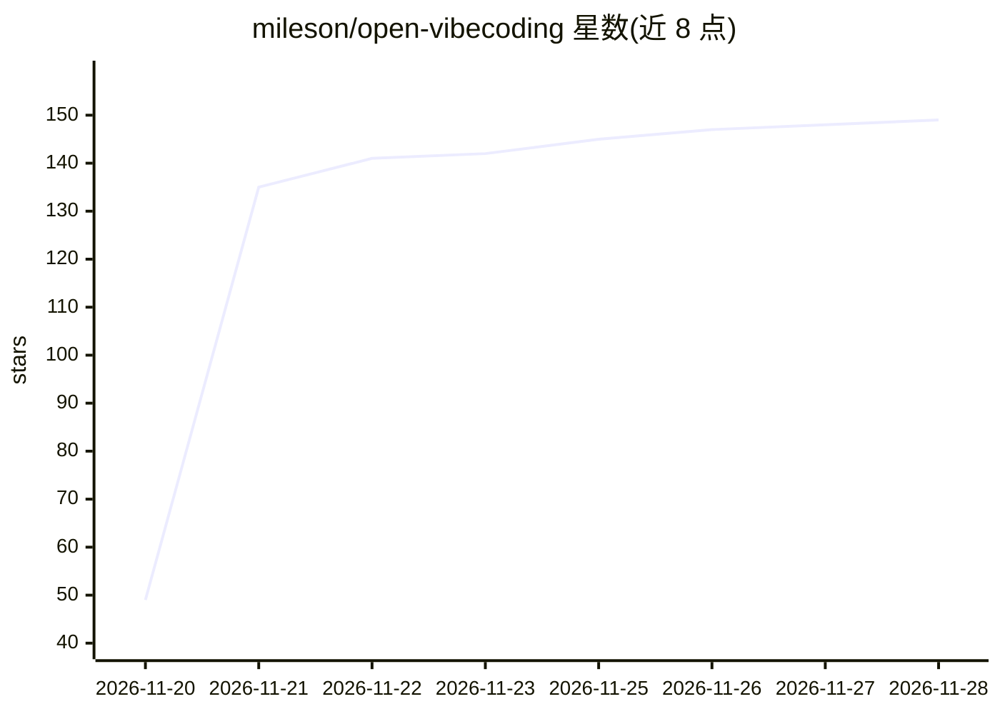

# mileson/open-vibecoding

⭐ 149 · JavaScript · MIT · 推送 2026-11-19 · [GitHub](https://github.com/mileson/open-vibecoding) · 个人维护 · 中文 README

**为编码 Agent 提供可审查工作流的协作框架**

Open VibeCoding 是一个接入现有编码 Agent（Codex、Claude Code、Cursor、Gemini CLI）的协作框架：用户描述任务，Agent 按需组合产品、交互设计、研发、测试等领域的 Skill，交付改动与验证结果。能力以 SKILL.md 形式保存在仓库内随版本管理，统筹层按用户意图组合子能力，并通过 CLI 提供确定性工具（测试报告、质量检查、Playwright/Maestro 工具准备、PRD 导出、知识库绑定）。需要 Node.js 20.19+ 与用户已有的编码 Agent，经 npm 全局安装后初始化项目。

## 筛选速览

| 维度 | 判定 | 备注 |
|---|---|---|
| AI 角色 | `ai-ecosystem` | LLM/agent 周边工具 |
| 许可风险 | `permissive` | MIT |
| 部署形态 | `library` | 以包/库形式分发 |
| 模型依赖 | — | README 未给出锁定关系 |
| 硬件要求 | — | 无带数字的原话,不猜 |
| 安装摩擦 | `low` | 无编译、无系统依赖或容器化 |
| 成熟度 | — | 结构信号不足 |

## 能力要点

- 按用户意图组合产品/设计/研发/测试 Skill，不靠固定关键词匹配
- 能力目录与路由入口提供机器可读接口（capabilities list|get|contract）
- 确定性 CLI 工具：test-report、project-quality、tools ensure、knowledge bind
- 业务 Skill 与项目经验统一存于 .agents/skills/ 随仓库管理，冲突时保留双版本供人工核对

## 适用场景

- 在现有项目中让 Agent 结合规范实现功能并交付验证结果
- 为改动生成测试用例、跑测试并产出 HTML 报告
- 绑定本地或飞书知识库供 Agent 引用业务规则
- 让 Agent 参照已有视觉语言生成和精修界面

## 场景标签

`编码 Agent` · 领域:编码与开发

## 证据(README 行号)

> L3: **让编码 Agent 从理解需求到交付验证，按任务选用产品、设计、研发和测试能力。**
> L5: 在现有项目中接入 Codex、Claude Code、Cursor 或 Gemini CLI。你描述想解决的问题，Agent 结合仓库和已绑定的资料选择 Skill，给出方案、落实改动并交付验证结果。
> L47: 每个场景是独立子能力，统筹层按用户意图组合它们，不靠固定关键词匹配。小任务可以只用一项；复杂任务可在领域之间往返。项目安装后的路由入口为 `.agents/internal-skills/open-vibecoding-route

## 星数曲线

2026-11-20 49 → 2026-11-28 149（+100）

---
*卡片 v1 · prompt 1.4 · 生成 2026-11-20 · 置信度 high · 依据 README sha `7a893df743ac` · [字段定义](../../DATASET.md)*
