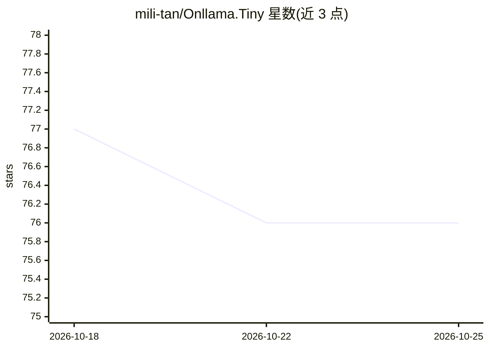

# mili-tan/Onllama.Tiny

⭐ 76 · C# · MPL-2.0 · 推送 2025-10-31 · [GitHub](https://github.com/mili-tan/Onllama.Tiny) · 个人维护 · 中文 README

**通过 Ollama 在电脑上运行 LLM 的图形界面客户端**

Ollama 的图形界面客户端，README 描述为‘比简单更简单’，通过 Ollama 在本地电脑上运行 LLM，且标注不需要显卡。提供 GitHub Release 形式的分发。README 信息量极少，未说明具体功能细节、技术栈或安装步骤；主题标签显示定位为 ollama-client / ollama-gui / ollama-ui，即面向 Ollama 的界面封装。

## 筛选速览

| 维度 | 判定 | 备注 |
|---|---|---|
| AI 角色 | `ai-ecosystem` | LLM/agent 周边工具 |
| 许可风险 | `permissive` | MPL-2.0 |
| 部署形态 | `None` |  |
| 模型依赖 | local-ok | 支持本地模型 |
| 硬件要求 | — | 无带数字的原话,不猜 |
| 安装摩擦 | `low` | 无编译、无系统依赖或容器化 |
| 成熟度 | — | 结构信号不足 |

## 能力要点

- 通过 Ollama 运行本地 LLM 的 GUI 客户端
- 标注无需显卡即可使用
- 以 GitHub Release 分发

## 适用场景

- 想在图形界面中使用 Ollama 运行本地 LLM
- 无显卡的电脑上体验本地模型

## 场景标签

`聊天机器人` · 领域:对话与助手

## 证据(README 行号)

> L2: 比简单更简单，通过 Ollama 不需要显卡轻松在你的电脑上运行 LLM。

## 星数曲线

2026-10-18 77 → 2026-10-25 76（-1）

---
*卡片 v1 · prompt 1.4 · 生成 2026-10-24 · 置信度 mid · 依据 README sha `261fb14c5fbb` · [字段定义](../../DATASET.md)*
