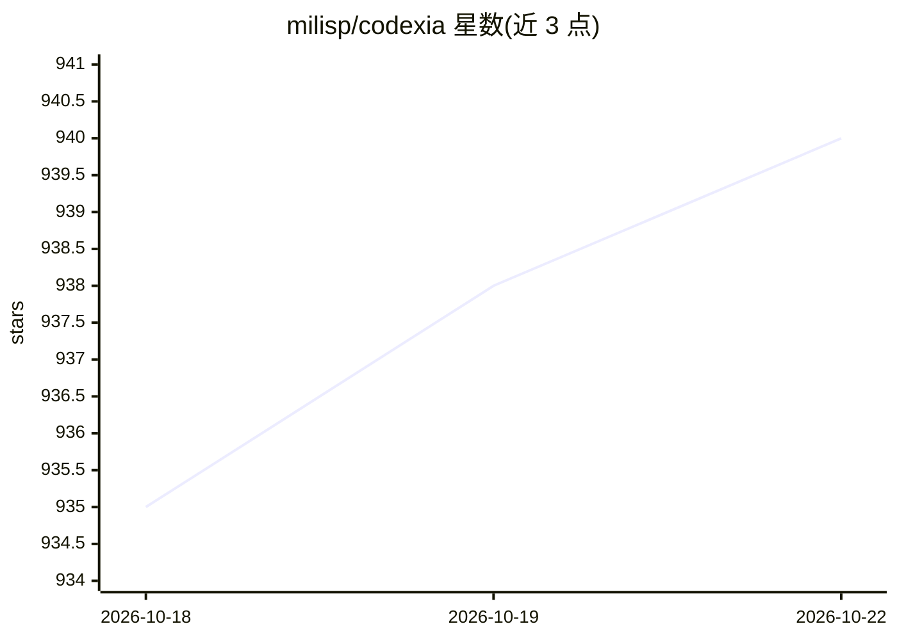

# milisp/codexia

⭐ 940 · TypeScript · MIT · 推送 2026-10-21 · [GitHub](https://github.com/milisp/codexia) · [官网](https://milisp.dev/codexia) · 个人维护

**聚合 Claude Code 与 Codex 的轻量 agent 桌面工作台**

基于 Tauri v2 + Rust 与 React 的桌面应用，作为统一工作区管理 Claude Code、Codex CLI 及任意 Agent Client Protocol (ACP) agent。核心功能包括：带持久记忆与定时例程的长期运行 Bot（信任级别由 OS sandbox 强制执行）、任务调度器、git worktree 管理、IDE 风格编辑器，以及通过 Axum headless web server 实现的远程控制（含 iOS 浏览器访问）。使用现有 Claude/ChatGPT 订阅登录，无需 API key。提供 Homebrew、Scoop 与预编译安装包，keke agent 内置于应用中。

## 筛选速览

| 维度 | 判定 | 备注 |
|---|---|---|
| AI 角色 | `ai-ecosystem` | LLM/agent 周边工具 |
| 许可风险 | `permissive` | MIT |
| 部署形态 | `None` |  |
| 模型依赖 | locked-api |  |
| 硬件要求 | — | 无带数字的原话,不猜 |
| 安装摩擦 | `low` | 无编译、无系统依赖或容器化 |
| 成熟度 | — | 结构信号不足 |

## 能力要点

- 统一管理 Claude Code、Codex 与 ACP agent，会话跨重启持久化
- 长期运行 Bot：持久记忆、定时例程、OS sandbox 强制的信任级别
- 任务调度器与 headless web server 远程控制（含 iOS）
- 内置 keke agent，提供 MCP server 与 agent skills 市场

## 适用场景

- 在同一工作区里运行和管理多个编码 agent
- 创建定时执行任务的 AI Bot 处理例行工作
- 通过手机浏览器远程控制本地 agent 会话

## 场景标签

`编码 Agent` `Agent 框架` · 领域:Agent 开发

## 证据(README 行号)

> L5:  A lightweight agent workstation for Claude Code and Codex
> L14: Build your team of **Bots** — long-lived AI coworkers with memory and scheduled routines. Manage Claude Code, Codex
> L91: - Claude agent rust sdk integration

## 星数曲线

2026-10-18 935 → 2026-10-22 940（+5）

---
*卡片 v1 · prompt 1.4 · 生成 2026-10-21 · 置信度 high · 依据 README sha `eead05b49d59` · [字段定义](../../DATASET.md)*
