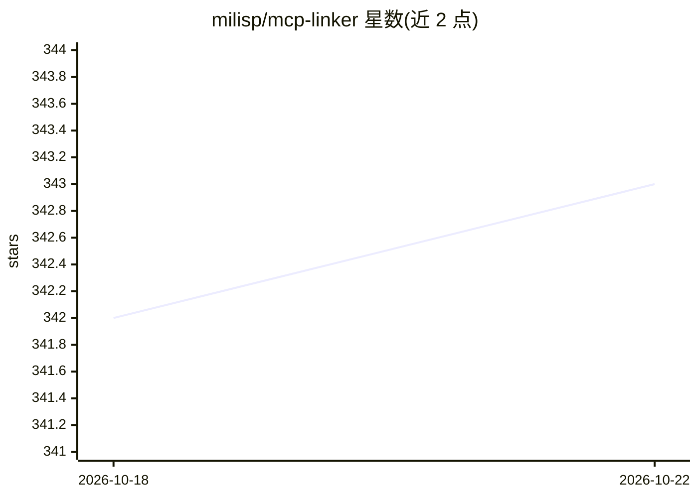

# milisp/mcp-linker

⭐ 343 · TypeScript · AGPL-3.0 · 推送 2026-10-22 · [GitHub](https://github.com/milisp/mcp-linker) · [官网](https://mcp-linker.milisp.dev) · 个人维护 · 中文 README

**跨 AI 客户端的一键 MCP 服务器安装与配置同步工具**

面向同时使用多个 AI 客户端（Claude Desktop/Code、Codex、Cursor、VS Code、Cline 等）的用户，提供 MCP 服务器的发现、安装与配置同步：内置市场浏览 registry.modelcontextprotocol.io 的官方注册表，一键添加服务器到指定客户端，或在客户端之间复制服务器配置（如从 Claude Code 同步到 Codex）。无需 LLM 调用。提供 GUI 应用（Homebrew/AUR/预编译二进制）与 CLI 工具 mcpl（npm 安装）。采用 AGPL-3.0 与商业许可双许可。

## 筛选速览

| 维度 | 判定 | 备注 |
|---|---|---|
| AI 角色 | `ai-ecosystem` | LLM/agent 周边工具 |
| 许可风险 | `dual` | AGPL-3.0 |
| 部署形态 | `library` | 以包/库形式分发 |
| 模型依赖 | — | README 未给出锁定关系 |
| 硬件要求 | — | 无带数字的原话,不猜 |
| 安装摩擦 | `low` | 无编译、无系统依赖或容器化 |
| 成熟度 | — | 结构信号不足 |

## 能力要点

- 跨 9 类 AI 客户端的 MCP 配置同步
- 内置市场对接官方 MCP 注册表，一键添加服务器
- CLI 工具 mcpl 支持批量添加与客户端间同步
- 自动检测 Python/Node.js/uv 运行环境

## 适用场景

- 在多个 AI 客户端间复用同一套 MCP 服务器配置
- 在市场里浏览并一键安装 MCP 服务器
- 用命令行批量管理本机各客户端的 MCP 配置

## 场景标签

 · 领域:AI 工具链/MCP 配置管理

## 证据(README 行号)

> L13: **One-click add and sync MCP servers across AI clients — No LLM calls needed, Built-in marketplace**
> L27: - **Local Sync** — Sync MCP server configs across multiple clients
> L29: - **Multi-Client Support** — Claude Desktop/Code, Codex, Cursor, VS Code, GitHub Copilot CLI, Cline, OpenCode, Pi, 

## 星数曲线

2026-10-18 342 → 2026-10-22 343（+1）

---
*卡片 v1 · prompt 1.4 · 生成 2026-10-21 · 置信度 high · 依据 README sha `01c6070741af` · [字段定义](../../DATASET.md)*
