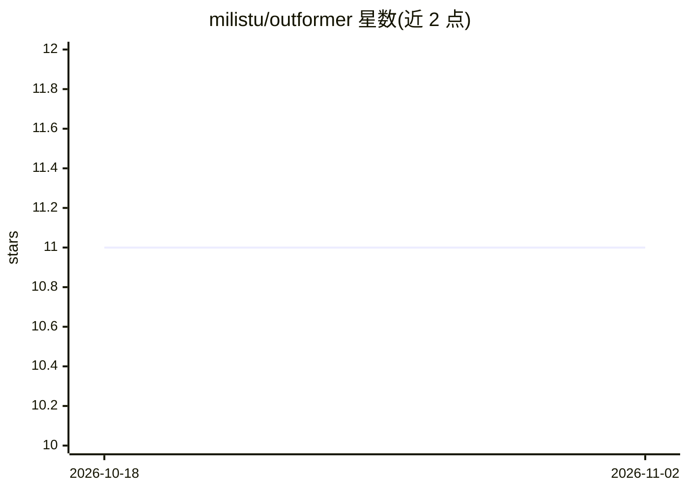

# milistu/outformer

⭐ 11 · Python · MIT · 推送 2026-05-30 · [GitHub](https://github.com/milistu/outformer) · [官网](https://outformer.readthedocs.io) · 个人维护

**让 Hugging Face 语言模型按 JSON schema 生成结构化输出的 Python 库**

受 jsonformer 启发的结构化输出库：基于给定 JSON schema，只让语言模型生成值部分，结构部分由库维护，从而保证输出始终为符合 schema 的合法 JSON。可与任意 Hugging Face transformer 模型配合使用，提供 debug、数组长度上限、token 上限、温度、重试次数等配置，支持基本类型、嵌套对象、数组与枚举，并附带终端中高亮生成值的可视化函数。以 pip 包与源码两种方式安装，要求 Python 3.10+、PyTorch 2.7.0+、transformers v4.51.3+。

## 筛选速览

| 维度 | 判定 | 备注 |
|---|---|---|
| AI 角色 | `ai-ecosystem` | LLM/agent 周边工具 |
| 许可风险 | `permissive` | MIT |
| 部署形态 | `library` | 以包/库形式分发 |
| 模型依赖 | — | README 未给出锁定关系 |
| 硬件要求 | — | 无带数字的原话,不猜 |
| 安装摩擦 | `low` | 无编译、无系统依赖或容器化 |
| 成熟度 | — | 结构信号不足 |

## 能力要点

- 只生成值、结构由库维护，保证输出符合 JSON schema
- 兼容任意 Hugging Face transformer 模型
- 支持嵌套对象、数组（min/max items）、枚举与描述
- 提供生成值终端高亮可视化（highlight_values）

## 适用场景

- 让本地 transformer 模型稳定产出可解析的 JSON 字段
- 在数据抽取/表单填充等场景约束模型输出格式
- 调试时区分 JSON 结构与模型生成内容

## 场景标签

 · 领域:LLM 基础设施/结构化生成

## 证据(README 行号)

> L11: Outformer is a powerful library that enables language models to generate structured outputs. It ensures always vali
> L17: - 🛠️ **Flexible Integration**: Works with any Hugging Face transformer model

## 星数曲线

2026-10-18 11 → 2026-11-02 11（+0）

---
*卡片 v1 · prompt 1.4 · 生成 2026-11-02 · 置信度 high · 依据 README sha `338f9450fe67` · [字段定义](../../DATASET.md)*
