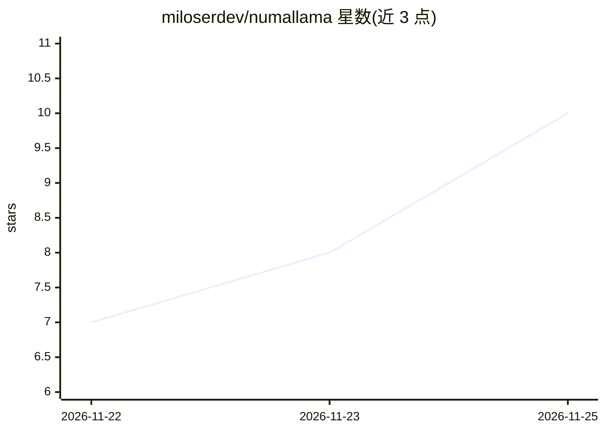

# miloserdev/numallama

⭐ 10 · C · MIT · 推送 2026-11-22 · [GitHub](https://github.com/miloserdev/numallama) · 个人维护 · 中文 README

**面向大 NUMA Arm 服务器的 Llama/Qwen 系列本地 CPU 推理引擎**

单文件 C 语言推理引擎（无第三方依赖），针对多路 NUMA 大型 Arm 服务器（Ampere Altra/Neoverse N1，NEON+dotprod）调优，源自 llama2.c 分支。支持 Llama 3.x、Qwen2.5、Qwen3/Qwen3-MoE、Qwen3.5/3.8 稠密模型；按 socket 拆分权重与 KV cache，提供 int8/4-bit 量化、推测解码、OpenAI 兼容 HTTP 服务端与带沙箱工具调用的 CLI 聊天。仅支持 Linux；模型文件为自有格式，不兼容 GGUF；服务端一次仅处理一个请求。

## 筛选速览

| 维度 | 判定 | 备注 |
|---|---|---|
| AI 角色 | `ai-native` | 本体是模型或模型工具 |
| 许可风险 | `permissive` | MIT |
| 部署形态 | `library` | 以包/库形式分发 |
| 模型依赖 | — | README 未给出锁定关系 |
| 硬件要求 | — | 无带数字的原话,不猜 |
| 安装摩擦 | `medium` | 含编译或系统依赖之一 |
| 成熟度 | — | 结构信号不足 |

## 能力要点

- 多路 NUMA 拆分权重与 KV cache，双 socket 解码提速 50–85%
- OpenAI 兼容服务端（流式、tool calls、前缀 KV 复用）
- int8/4-bit 量化含引擎自采重要性矩阵，推测解码（prompt lookup + draft 模型）
- 单 .c 文件实现，make 即可构建，无第三方依赖

## 适用场景

- 在多路 NUMA Arm 服务器上本地运行 Llama/Qwen 模型做聊天
- 通过 OpenAI 兼容 API 接入现有客户端做本地推理服务
- 在 CPU 环境下测试 Qwen3-MoE 与混合注意力模型的推理

## 场景标签

`推理引擎` `模型量化` · 领域:训练与推理

## 证据(README 行号)

> L3: # numallama — fast NUMA-aware CPU inference for Llama 3.x, Qwen2.5, Qwen3 / Qwen3-MoE and Qwen3.5 / 3.8
> L32: - **OpenAI-compatible server** (`-m server`): `/v1/chat/completions` with streaming, tool calls and
> L131: - **One request at a time.** A request already uses every core, so concurrent requests wait in the

## 星数曲线

2026-11-22 7 → 2026-11-25 10（+3）

---
*卡片 v1 · prompt 1.4 · 生成 2026-11-22 · 置信度 mid · 依据 README sha `08e3b6c25892` · [字段定义](../../DATASET.md)*
