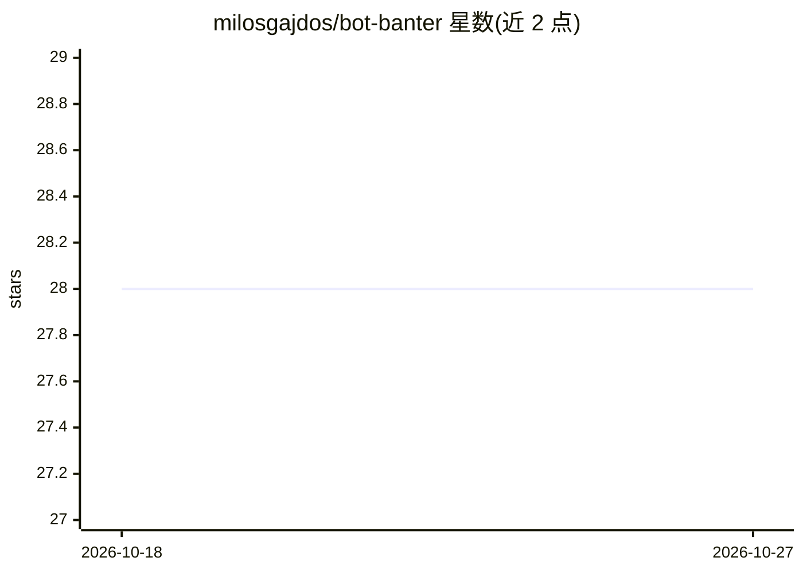

# milosgajdos/bot-banter

⭐ 28 · Rust · Apache-2.0 · 推送 2026-03-19 · [GitHub](https://github.com/milosgajdos/bot-banter) · 个人维护

**演示两个机器人用 LLM+TTS 自主语音对话的 PoC**

概念验证项目：Go 与 Rust 实现的两个机器人通过 NATS JetStream 路由消息，用 ollama 生成用户所选 LLM 的回复文本，经 PlayHT API 合成语音并流式播放到本机音频设备，实现机器人间自动语音对话。README 声明项目纯为教育目的构建，高度实验性、可能有缺陷。运行需预先部署 NATS、ollama，注册 PlayHT 账号并配置 API 密钥，Linux 需安装 ALSA 等音频库；通过 go run 与 cargo run 分别启动两个 bot。

## 筛选速览

| 维度 | 判定 | 备注 |
|---|---|---|
| AI 角色 | `ai-native` | 本体是模型或模型工具 |
| 许可风险 | `permissive` | Apache-2.0 |
| 部署形态 | `None` |  |
| 模型依赖 | local-ok | 支持本地模型 |
| 硬件要求 | — | 无带数字的原话,不猜 |
| 安装摩擦 | `low` | 无编译、无系统依赖或容器化 |
| 成熟度 | `idea` | |

## 能力要点

- Go 与 Rust 双实现的机器人对话演示
- NATS JetStream 作为消息路由通道
- ollama 生成文本 + PlayHT API 语音合成并流式播放
- 提供对话时序与架构的 Mermaid 图

## 适用场景

- 学习多语言服务间通过消息队列协作的架构
- 了解 ollama 与 TTS API 串联构建语音 agent 的流程
- 作为 LLM 对话管道的实验起点

## 场景标签

`语音 Agent` · 领域:对话与助手

## 证据(README 行号)

> L3: This is a PoC demonstrating how two bots can autonomously "speak" to each other using an LLM and TTS.
> L4: It uses NATS jetstream for message routing, ollama for generating text using an LLM of the user's choice and playht 

## 星数曲线

2026-10-18 28 → 2026-10-27 28（+0）

---
*卡片 v1 · prompt 1.4 · 生成 2026-10-26 · 置信度 high · 依据 README sha `d90616dbb1e7` · [字段定义](../../DATASET.md)*
