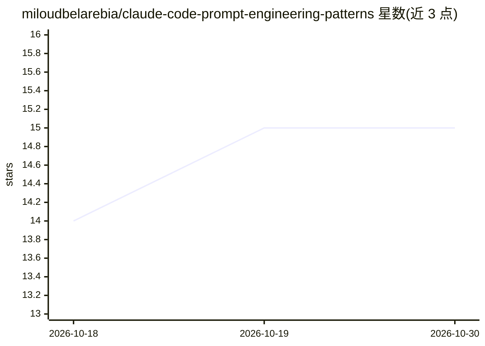

# miloudbelarebia/claude-code-prompt-engineering-patterns

⭐ 15 · Python · 推送 2026-04-01 · [GitHub](https://github.com/miloudbelarebia/claude-code-prompt-engineering-patterns) · [官网](https://2pidata.fr) · 个人维护

**从 Claude Code 源码泄漏逆向出的 10 个提示工程模式（Python 实现）**

对 2026 年 3 月 Claude Code npm 泄漏源码（512,000 行 TypeScript）进行分析后整理的 10 个生产级提示工程模式，附原创 Python 实现，声明不含任何 Anthropic 专有代码。内容包括：系统提示架构、内部/外部用户差异化规则、Undercover 模式、30+ 隐藏功能标志（如 KAIROS 自主模式、多代理协调）、单段安全边界指令、提示缓存成本优化等发现。面向构建 AI 编码代理、多代理系统的开发者与提示工程师，MIT 许可。

## 筛选速览

| 维度 | 判定 | 备注 |
|---|---|---|
| AI 角色 | `ai-knowledge` | 知识聚合/清单类 |
| 许可风险 | `none` | — |
| 部署形态 | `None` |  |
| 模型依赖 | — | README 未给出锁定关系 |
| 硬件要求 | — | 无带数字的原话,不猜 |
| 安装摩擦 | `low` | 无编译、无系统依赖或容器化 |
| 成熟度 | — | 结构信号不足 |

## 能力要点

- 10 个从泄漏源码提取的提示工程模式与 Python 实现
- 文档化内部/外部用户差异化规则与 30+ 隐藏功能标志
- 提示缓存分界机制带来约 94% 成本节省的分析
- 声明不含 Anthropic 专有代码，全部为原创实现

## 适用场景

- 构建 AI 编码代理或 copilot 时参考生产级提示模式
- 实现多代理系统时借鉴隐藏功能标志设计
- 优化 LLM 应用的提示缓存与成本结构

## 场景标签

`提示工程` `多智能体` · 领域:Agent 开发

## 证据(README 行号)

> L3: > Reverse-engineered from the Claude Code source leak (March 31, 2026). 10 production patterns documented and implem
> L14: This repo does **NOT** contain any Anthropic code. It documents the **techniques and patterns** with original Pytho
> L102: - Developers building AI coding agents or copilots

## 星数曲线

2026-10-18 14 → 2026-10-30 15（+1）

---
*卡片 v1 · prompt 1.4 · 生成 2026-10-30 · 置信度 high · 依据 README sha `26b2b094a5fd` · [字段定义](../../DATASET.md)*
