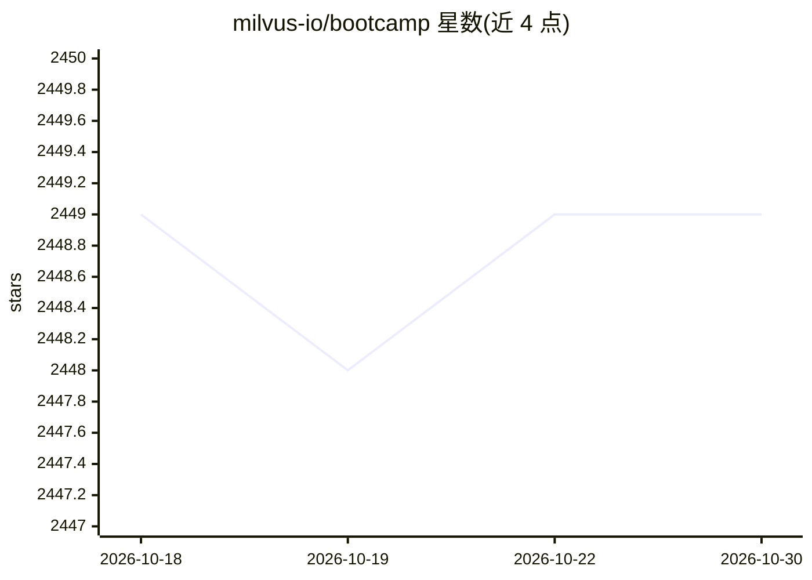

# milvus-io/bootcamp

⭐ 2,449 · Jupyter Notebook · Apache-2.0 · 推送 2026-10-21 · [GitHub](https://github.com/milvus-io/bootcamp) · [官网](https://milvus.io) · 组织维护

**Milvus 向量数据库的教程与示例集合（RAG/语义检索等）**

由 Milvus 官方维护的 bootcamp 仓库：提供 notebooks 教程、可部署 demo 和与外部框架集成的实践示例，主题覆盖 RAG、语义检索、混合检索、问答、推荐系统与快速入门，并按所用 Milvus 特性（向量检索、全文检索、多向量等）组织表格索引。面向使用 Milvus 构建向量检索与 AI 应用（含药物发现、图像检索）的开发者。不含产品本体安装说明，主体为学习与演示材料。

## 筛选速览

| 维度 | 判定 | 备注 |
|---|---|---|
| AI 角色 | `ai-knowledge` | 知识聚合/清单类 |
| 许可风险 | `permissive` | Apache-2.0 |
| 部署形态 | `None` |  |
| 模型依赖 | — | README 未给出锁定关系 |
| 硬件要求 | — | 无带数字的原话,不猜 |
| 安装摩擦 | `low` | 无编译、无系统依赖或容器化 |
| 成熟度 | — | 结构信号不足 |

## 能力要点

- 教程覆盖 RAG、语义检索、混合检索、问答、推荐等主题
- 示例按关联 Milvus 特性（向量检索/全文检索/多向量）索引
- 包含与 LangChain、LlamaIndex 等框架集成的教程
- 提供图像检索、药物发现等场景 demo

## 适用场景

- 学习如何用 Milvus 搭建 RAG 或语义检索应用
- 查找 Milvus 与 LangChain/LlamaIndex 的集成示例
- 按 Milvus 特性选择合适教程快速上手

## 场景标签

`教程课程` · 领域:学习与行业

## 证据(README 行号)

> L14: - **Explore Tutorials:** Dive into notebooks that walk you through diverse Milvus use cases.
> L44: Here is a selection of demos and tutorials to show how to build various types of AI applications made with Milvus:

## 星数曲线

2026-10-18 2,449 → 2026-10-30 2,449（+0）

---
*卡片 v1 · prompt 1.4 · 生成 2026-10-21 · 置信度 high · 依据 README sha `74798af73a01` · [字段定义](../../DATASET.md)*
