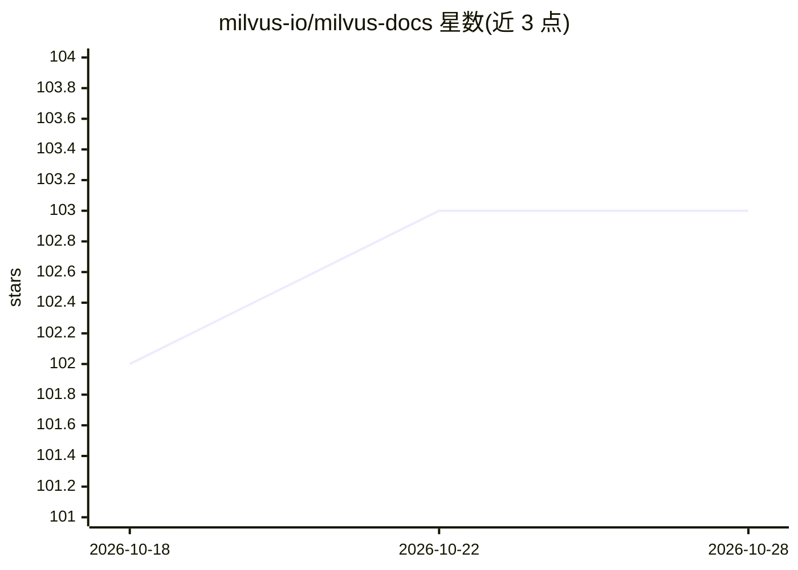

# milvus-io/milvus-docs

⭐ 103 · JavaScript · Apache-2.0 · 推送 2026-10-28 · [GitHub](https://github.com/milvus-io/milvus-docs) · 组织维护

**Milvus 向量数据库的官方技术文档仓库**

存放 Milvus 向量数据库的技术文档，每个分支对应一个 Milvus 版本，默认分支为最新版本（v3.0.x），v2.5 之前版本的文档保留在对应分支但不再维护。仓库接受通过 issue 提交修改建议与文档贡献，并附带 edit-docs agent 技能，指导 AI 编码代理修改或新增文档页面并以 pull request 形式交付改动。SDK API 文档与博客内容分别托管在语言专属仓库与社区仓库。面向使用和贡献 Milvus 文档的用户。

## 筛选速览

| 维度 | 判定 | 备注 |
|---|---|---|
| AI 角色 | `ai-knowledge` | 知识聚合/清单类 |
| 许可风险 | `permissive` | Apache-2.0 |
| 部署形态 | `None` |  |
| 模型依赖 | — | README 未给出锁定关系 |
| 硬件要求 | — | 无带数字的原话,不猜 |
| 安装摩擦 | `low` | 无编译、无系统依赖或容器化 |
| 成熟度 | — | 结构信号不足 |

## 能力要点

- 分支按 Milvus 版本组织，默认分支对应最新发布版
- 提供 edit-docs agent 技能，让 AI 编码代理以 PR 形式修改文档
- 接受 issue 报告的修改建议与社区文档贡献
- 含研究论文引用条目（BibTeX）

## 适用场景

- 查找特定 Milvus 版本的官方文档
- 为 Milvus 文档提交修改或新增主题
- 借助 AI 编码代理参与文档编辑

## 场景标签

`教程课程` · 领域:学习与行业

## 证据(README 行号)

> L5: This repository contains technical documentation for Milvus, the world's most advanced open-source vector database. 
> L7: Each branch corresponds to a Milvus release by name. We've set the branch of the latest Milvus release as the defaul

## 星数曲线

2026-10-18 102 → 2026-10-28 103（+1）

---
*卡片 v1 · prompt 1.4 · 生成 2026-10-23 · 置信度 high · 依据 README sha `7f18d20ea12c` · [字段定义](../../DATASET.md)*
