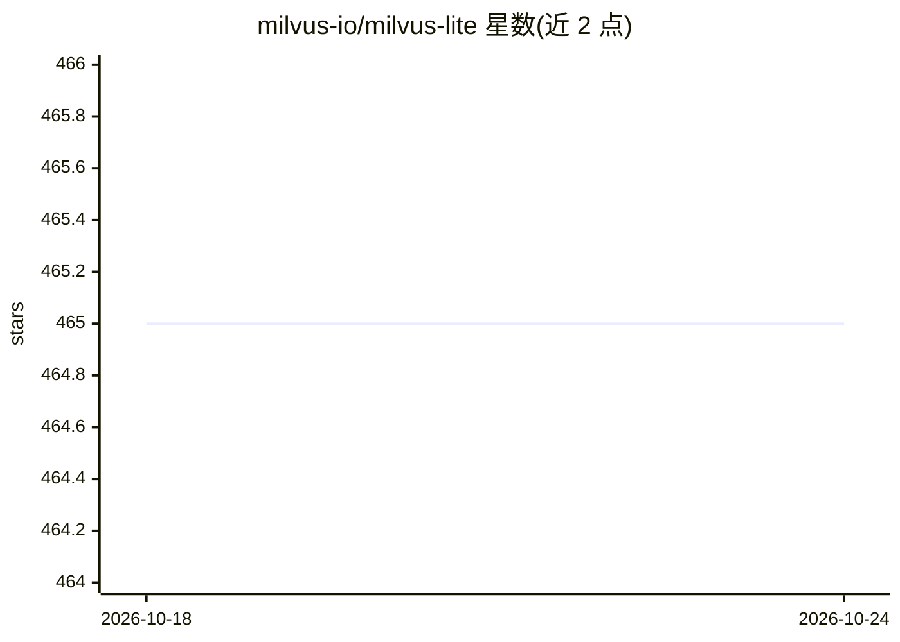

# milvus-io/milvus-lite

⭐ 464 · Python · Apache-2.0 · 推送 2026-10-20 · [GitHub](https://github.com/milvus-io/milvus-lite) · 组织维护

**本地开发测试用的轻量级 Milvus 向量数据库（纯 Python）**

Milvus 的轻量级纯 Python 实现，面向本地开发、notebook、测试与小规模 AI 应用。通过 pymilvus API 访问本地 .db 文件或嵌入式 gRPC 服务器，代码可近乎无改动迁移到 Milvus Standalone、Distributed 或 Zilliz Cloud。核心机制为 LSM 式存储（WAL、内存表、不可变 Parquet 段）、FAISS 向量索引、标量过滤、BM25 全文检索与混合检索。限制：面向原型与本地负载，无认证/RBAC/TLS，不支持并发写，旧版 .db 文件格式不兼容且无自动迁移。

## 筛选速览

| 维度 | 判定 | 备注 |
|---|---|---|
| AI 角色 | `ai-ecosystem` | LLM/agent 周边工具 |
| 许可风险 | `permissive` | Apache-2.0 |
| 部署形态 | `library` | 以包/库形式分发 |
| 模型依赖 | — | README 未给出锁定关系 |
| 硬件要求 | — | 无带数字的原话,不猜 |
| 安装摩擦 | `low` | 无编译、无系统依赖或容器化 |
| 成熟度 | — | 结构信号不足 |

## 能力要点

- MilvusClient('./demo.db') 即可本地使用，兼容 pymilvus API
- 纯 Python 实现，LSM 存储 + WAL + 不可变 Parquet 段 + FAISS 索引
- 稠密/稀疏向量检索、BM25 全文检索与混合检索（WeightedRanker/RRFRanker）
- 提供可长期运行的本地 gRPC 服务器与 BulkWriter JSON 导出工具

## 适用场景

- 在笔记本或测试环境中快速搭建 Milvus 兼容向量库
- AI 应用原型开发后再迁移到 Milvus 集群或 Zilliz Cloud
- 本地多客户端开发时以 gRPC 服务器模式运行
- 将本地集合导出为 BulkWriter JSON 用于 Milvus/Zilliz Cloud 导入

## 场景标签

`向量数据库` · 领域:知识与检索

## 证据(README 行号)

> L9: Milvus Lite is a lightweight version of Milvus for local development, notebooks, tests, and small-scale AI applicati
> L13: Milvus Lite is intended for prototyping and local workloads. For large-scale production deployments, use Milvus Sta

## 星数曲线

2026-10-18 465 → 2026-10-24 465（+0）

---
*卡片 v1 · prompt 1.4 · 生成 2026-10-21 · 置信度 high · 依据 README sha `2667e712a62a` · [字段定义](../../DATASET.md)*
