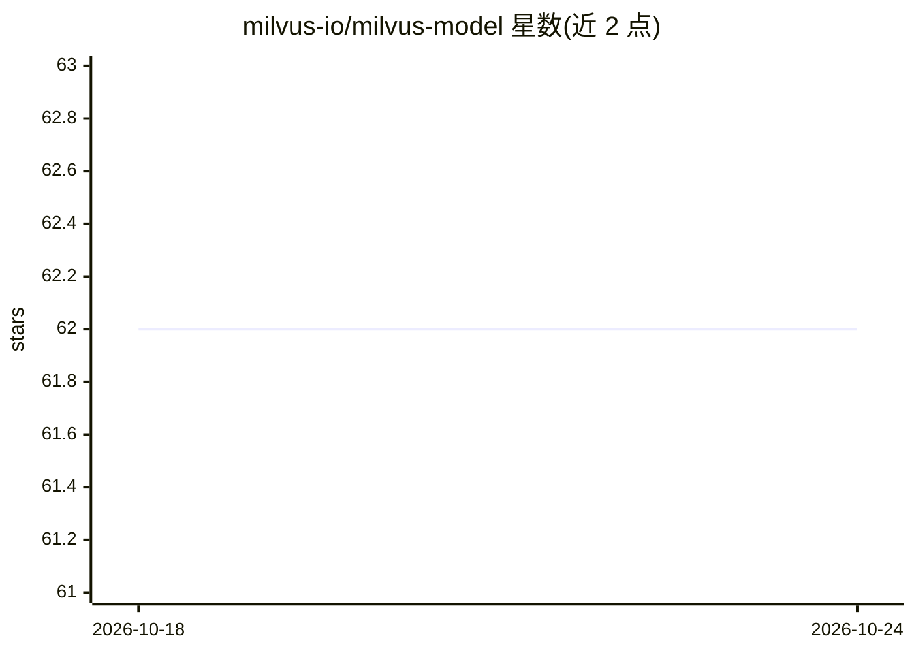

# milvus-io/milvus-model

⭐ 62 · Python · Apache-2.0 · 推送 2026-09-23 · [GitHub](https://github.com/milvus-io/milvus-model) · [官网](https://milvus.io/docs/embeddings.md) · 组织维护

**为 Milvus 向量库集成 embedding 与 reranker 模型的 Python 库**

milvus-model 是 Milvus 向量数据库生态的模型集成库，接入 OpenAI、Voyage AI、Cohere、Jina AI 等服务商的 embedding 与 reranker 模型，以及通过 SentenceTransformers、Hugging Face TEI 使用的开源模型。它作为 pymilvus（Milvus 官方 Python SDK）的依赖或可选组件分发，可通过 pip install pymilvus[model] 或直接 pip install milvus.model 安装，支持 Python 3.8 及以上。用于在 Milvus 语义检索流程中生成与重排向量。

## 筛选速览

| 维度 | 判定 | 备注 |
|---|---|---|
| AI 角色 | `ai-ecosystem` | LLM/agent 周边工具 |
| 许可风险 | `permissive` | Apache-2.0 |
| 部署形态 | `library` | 以包/库形式分发 |
| 模型依赖 | locked-api |  |
| 硬件要求 | — | 无带数字的原话,不猜 |
| 安装摩擦 | `low` | 无编译、无系统依赖或容器化 |
| 成熟度 | — | 结构信号不足 |

## 能力要点

- 接入 OpenAI、Voyage AI、Cohere、Jina AI 等服务商的 embedding 与 reranker 模型
- 支持通过 SentenceTransformers 与 Hugging Face TEI 使用开源模型
- 作为 pymilvus（Milvus Python SDK）的依赖分发

## 适用场景

- 在 Milvus 向量库中生成文档 embedding 用于语义检索
- 对检索结果调用 reranker 模型重排
- 为基于 pymilvus 的 RAG 应用补齐模型接入层

## 场景标签

`语义搜索` · 领域:知识与检索

## 证据(README 行号)

> L3: The `milvus-model` library provides the integration with common embedding and reranker models for Milvus, a high per
> L5: `milvus-model` supports embedding and reranker models from service providers like OpenAI, Voyage AI, Cohere, Jina AI

## 星数曲线

2026-10-18 62 → 2026-10-24 62（+0）

---
*卡片 v1 · prompt 1.4 · 生成 2026-10-24 · 置信度 high · 依据 README sha `95f584f6f511` · [字段定义](../../DATASET.md)*
