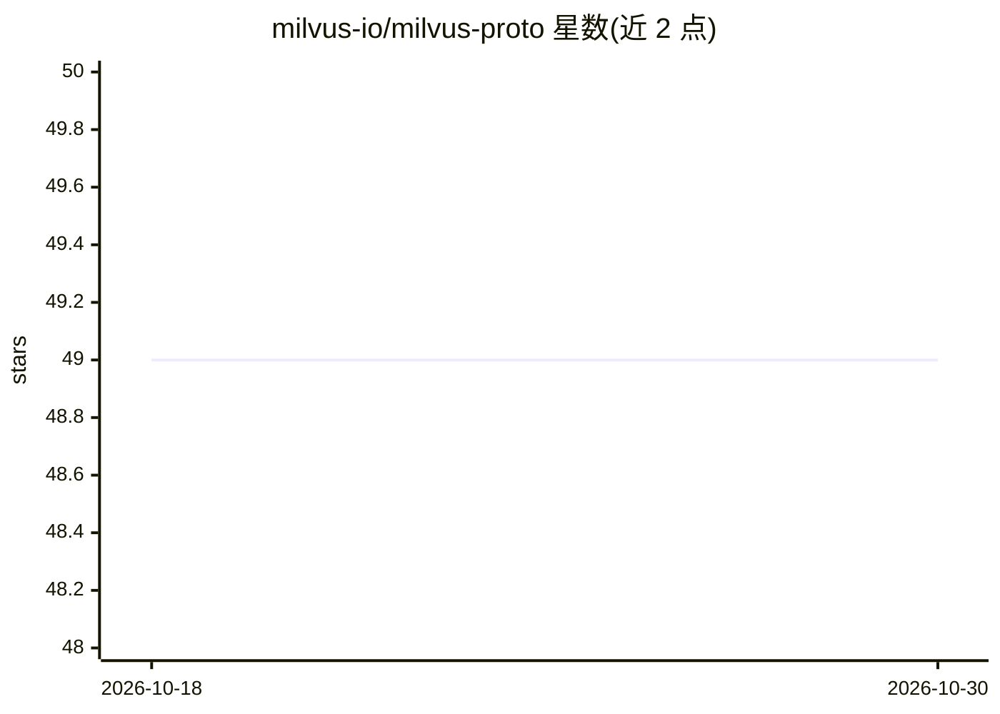

# milvus-io/milvus-proto

⭐ 49 · Go · Apache-2.0 · 推送 2026-10-29 · [GitHub](https://github.com/milvus-io/milvus-proto) · 组织维护

**Milvus 各 SDK 间共享 protobuf 接口定义的仓库**

存放 Milvus 向量数据库的 proto 接口定义文件，供主仓库与各语言 SDK（pymilvus、Java、C++、Go、Node、C# SDK）以 git submodule 形式共享使用。仓库仅分发 proto 文件，各 SDK 项目自行编译。使用方式为 git submodule add 添加、submodule update 更新；仓库只有 master 分支，官方版本以 tag（v2.0.0、v2.0.1 等）标记，SDK 开发可 checkout 特定 tag 后提交至 SDK 项目。

## 筛选速览

| 维度 | 判定 | 备注 |
|---|---|---|
| AI 角色 | `ai-ecosystem` | LLM/agent 周边工具 |
| 许可风险 | `permissive` | Apache-2.0 |
| 部署形态 | `None` |  |
| 模型依赖 | — | README 未给出锁定关系 |
| 硬件要求 | — | 无带数字的原话,不猜 |
| 安装摩擦 | `low` | 无编译、无系统依赖或容器化 |
| 成熟度 | — | 结构信号不足 |

## 能力要点

- 以 git submodule 形式在多个 SDK 仓库间共享 proto 文件
- 覆盖 pymilvus/Java/C++/Go/Node/C# 六个官方 SDK
- 仅分发 proto 文件，由各 SDK 项目自行编译
- 通过 tag 标记官方版本以支持基于特定版本的 SDK 开发

## 适用场景

- 为 Milvus SDK 项目引入或更新 proto 接口定义
- 基于特定 proto 版本（tag/commit）开发 SDK
- 跨语言 SDK 保持接口定义一致

## 场景标签

 · 领域:数据库/开发者基础设施

## 证据(README 行号)

> L1: # Brief
> L2: Share Milvus proto files across SDK repositories.

## 星数曲线

2026-10-18 49 → 2026-10-30 49（+0）

---
*卡片 v1 · prompt 1.4 · 生成 2026-10-25 · 置信度 high · 依据 README sha `0a5c776f7fad` · [字段定义](../../DATASET.md)*
