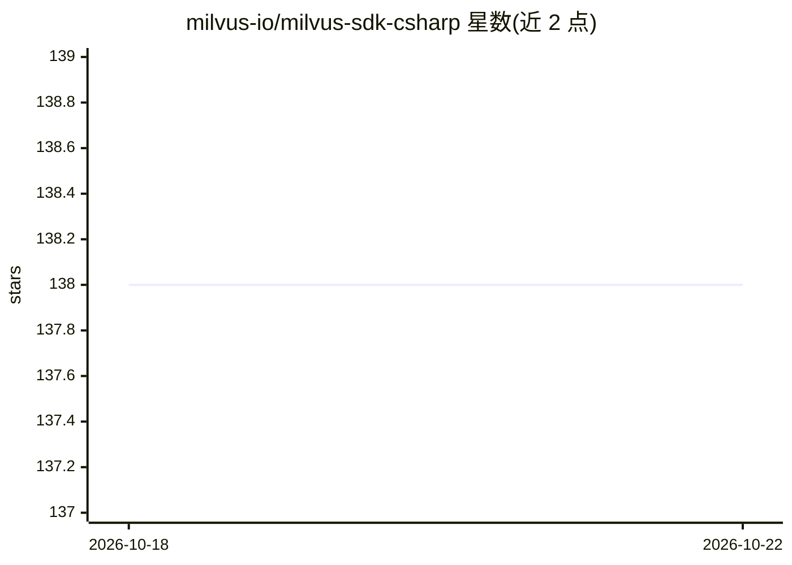

# milvus-io/milvus-sdk-csharp

⭐ 138 · C# · Apache-2.0 · 推送 2026-10-21 · [GitHub](https://github.com/milvus-io/milvus-sdk-csharp) · 组织维护

**Milvus 向量数据库的官方 C#/.NET SDK**

Milvus 官方 C# SDK，以 NuGet 包分发，供 .NET 应用连接 Milvus 向量数据库，执行集合创建、数据插入、加载、索引、向量搜索、查询、RBAC 等操作。仓库含两代 SDK：V2（Milvus.Client.V2，请求/响应式 DTO API，与 Java/C++/Rust V2 SDK 对齐，支持 .NET 8）为当前版本，V1（Milvus.Client）为维护模式的旧版，支持 .NET Core 2.1+ 与 .NET Framework 4.6.1+。提供 8 个渐进式教程、示例工程与基于 Microsoft.Extensions.Logging 的诊断日志（不记录凭据与向量数据）。

## 筛选速览

| 维度 | 判定 | 备注 |
|---|---|---|
| AI 角色 | `ai-ecosystem` | LLM/agent 周边工具 |
| 许可风险 | `permissive` | Apache-2.0 |
| 部署形态 | `None` |  |
| 模型依赖 | — | README 未给出锁定关系 |
| 硬件要求 | — | 无带数字的原话,不猜 |
| 安装摩擦 | `medium` | 含编译或系统依赖之一 |
| 成熟度 | — | 结构信号不足 |

## 能力要点

- V2 请求/响应式 DTO API，与 Java/C++/Rust V2 SDK 对齐
- 经 gRPC 连接 Milvus 2.2.x–2.6.x，附版本兼容表
- 8 个教程（Quickstart 到 RBAC）与 V1/V2 示例工程
- 日志诊断：记录重试与 RPC 失败，不记录凭据与向量数据

## 适用场景

- 在 .NET 应用中连接并操作 Milvus 向量数据库
- 按教程学习集合、Schema、索引与 DML/DQL 操作
- 从 V1 SDK 迁移到 V2 API

## 场景标签

`向量数据库` · 领域:知识与检索

## 证据(README 行号)

> L3: The official C# SDK for Milvus.
> L41: dotnet add package Milvus.Client.V2

## 星数曲线

2026-10-18 138 → 2026-10-22 138（+0）

---
*卡片 v1 · prompt 1.4 · 生成 2026-10-22 · 置信度 high · 依据 README sha `8d6ebc5a0daf` · [字段定义](../../DATASET.md)*
