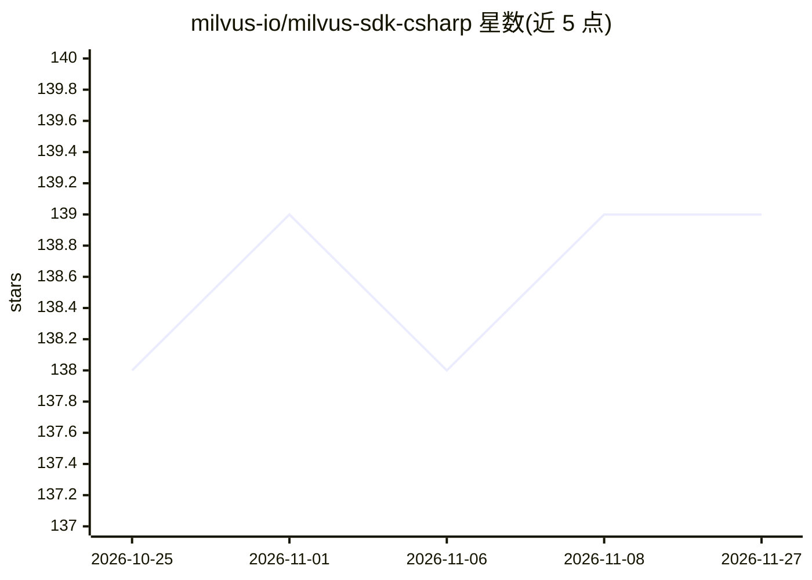

# milvus-io/milvus-sdk-csharp

⭐ 139 · C# · Apache-2.0 · 推送 2026-11-24 · [GitHub](https://github.com/milvus-io/milvus-sdk-csharp) · 组织维护

**面向 .NET 开发者的 Milvus 向量数据库官方 C# 客户端**

Milvus 向量数据库的官方 C# SDK，仓库内含两代客户端：V2（Milvus.Client.V2）为当前的请求/响应式 API，V1（Milvus.Client）处于维护模式。SDK 经 NuGet 分发，支持 .NET 8（V2）与 .NET Core 2.1+/Framework 4.6.1+（V1）。README 提供连接示例、8 个进阶式教程工程、示例程序目录，以及连接诊断、日志配置（基于 Microsoft.Extensions.Logging）与故障排查指引。V1 另附 Jupyter 笔记本。

## 筛选速览

| 维度 | 判定 | 备注 |
|---|---|---|
| AI 角色 | `ai-ecosystem` | LLM/agent 周边工具 |
| 许可风险 | `permissive` | Apache-2.0 |
| 部署形态 | `None` |  |
| 模型依赖 | — | README 未给出锁定关系 |
| 硬件要求 | — | 无带数字的原话,不猜 |
| 安装摩擦 | `medium` | 含编译或系统依赖之一 |
| 成熟度 | — | 结构信号不足 |

## 能力要点

- V2/V1 两代客户端并存，V2 与 Java/C++/Rust V2 SDK 的 API 对齐
- NuGet 包分发，dotnet add package 安装
- tutorial 目录提供 8 个从入门到进阶的独立控制台教程工程
- 内置诊断日志：记录重试、健康检查与 RPC 失败，不记录凭据与向量数据

## 适用场景

- 在 C#/.NET 应用中连接并操作 Milvus 向量数据库
- 按教程工程从建集合、插入向量学到搜索与 RBAC
- 在 .NET 项目中接入向量检索能力做应用开发

## 场景标签

`向量数据库` · 领域:知识与检索

## 证据(README 行号)

> L3: The official C# SDK for Milvus.
> L20: |**V2** — `Milvus.Client.V2`|`Milvus.Client.V2.dll`|Current; request/response DTO API aligned with the Java/C++/Rus
> L35: New applications should use `MilvusClientV2`, which provides the current request/response-style API.

## 星数曲线

2026-10-25 138 → 2026-11-27 139（+1）

---
*卡片 v1 · prompt 1.4 · 生成 2026-11-27 · 置信度 high · 依据 README sha `3544384853ab` · [字段定义](../../DATASET.md)*
