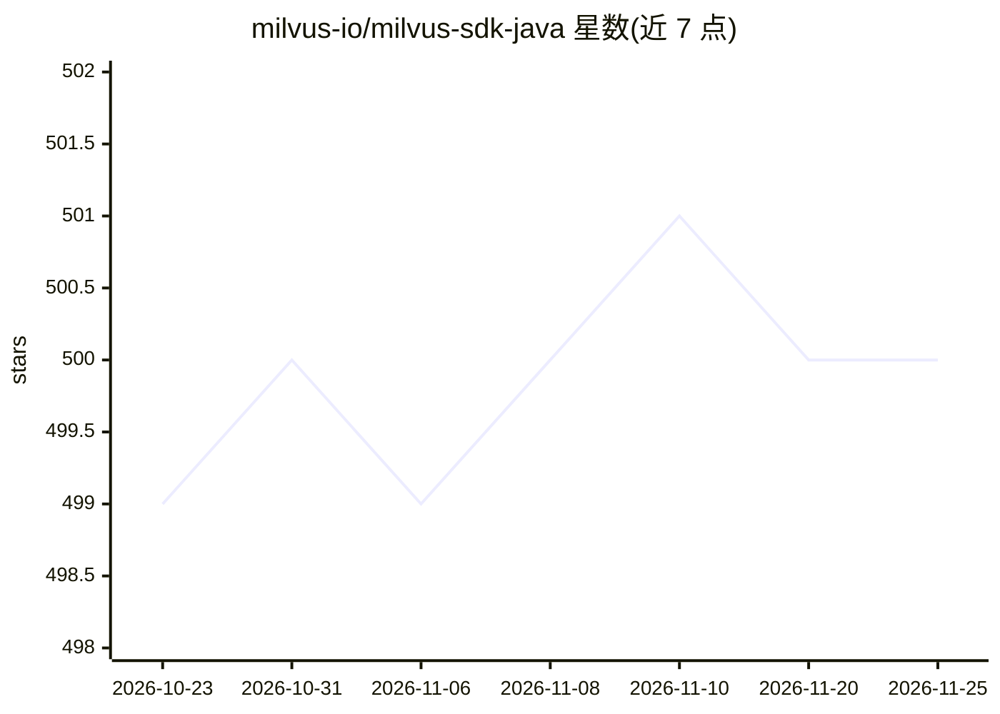

# milvus-io/milvus-sdk-java

⭐ 500 · Java · Apache-2.0 · 推送 2026-11-23 · [GitHub](https://github.com/milvus-io/milvus-sdk-java) · [官网](https://milvus.io) · 组织维护

**Java 开发者连接 Milvus 向量数据库的官方 SDK**

Milvus 向量数据库的 Java SDK，通过 Maven Central 发布，提供 milvus-sdk-java 主包与自 v2.5.2 拆分的 milvus-sdk-java-bulkwriter 批量写入包。README 给出 Maven/Gradle/Kotlin 三种依赖引入方式，附 SDK 与 Milvus 各版本的兼容对照表（2.0 至 3.0.x），并针对 Java 17+ 的 Spring Boot 应用提供自动配置 MilvusClientV2 的 starter 包。要求 Java 8 以上，examples 目录含示例代码。

## 筛选速览

| 维度 | 判定 | 备注 |
|---|---|---|
| AI 角色 | `ai-ecosystem` | LLM/agent 周边工具 |
| 许可风险 | `permissive` | Apache-2.0 |
| 部署形态 | `None` |  |
| 模型依赖 | — | README 未给出锁定关系 |
| 硬件要求 | — | 无带数字的原话,不猜 |
| 安装摩擦 | `medium` | 含编译或系统依赖之一 |
| 成熟度 | — | 结构信号不足 |

## 能力要点

- Maven Central 发布，支持 Maven/Gradle/Groovy/Kotlin 引入
- 提供 SDK 与 Milvus 2.0–3.0.x 的版本兼容对照表
- v2.5.2 起拆分出独立的 bulkwriter 包以减少依赖
- 提供 Spring Boot starter 自动配置 MilvusClientV2

## 适用场景

- 在 Java 项目中读写 Milvus 向量数据库
- 批量导入数据到 Milvus（BulkWriter 包）
- Spring Boot 应用中通过配置项接入 Milvus 客户端

## 场景标签

`向量数据库` · 领域:知识与检索

## 证据(README 行号)

> L1: # Milvus Java SDK
> L79: For Spring Boot applications (Java 17+), the `milvus-sdk-java-spring-boot-starter` package auto-configures a `Milvu

## 星数曲线

2026-10-23 499 → 2026-11-25 500（+1）

---
*卡片 v1 · prompt 1.4 · 生成 2026-11-25 · 置信度 high · 依据 README sha `9984d027ab11` · [字段定义](../../DATASET.md)*
