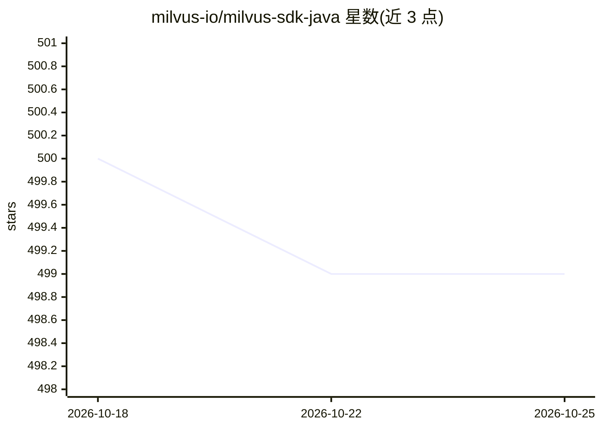

# milvus-io/milvus-sdk-java

⭐ 499 · Java · Apache-2.0 · 推送 2026-10-23 · [GitHub](https://github.com/milvus-io/milvus-sdk-java) · [官网](https://milvus.io) · 组织维护

**Java 开发者连接与操作 Milvus 向量数据库的官方 SDK**

Milvus 官方维护的 Java 客户端 SDK，供 Java 应用通过 Maven/Gradle 引入后连接 Milvus 向量数据库并执行操作。README 提供 Milvus 版本与 SDK 版本的兼容对照表（2.0 至 3.0.x），并说明自 v2.5.2 起拆分为 milvus-sdk-java 与 milvus-sdk-java-bulkwriter 两个包，BulkWriter 依赖较多可按需引入。前置要求为 Java 8+ 与 Maven 或 Gradle，日志依赖 SLF4J。仓库附 examples 目录与贡献指南。

## 筛选速览

| 维度 | 判定 | 备注 |
|---|---|---|
| AI 角色 | `ai-ecosystem` | LLM/agent 周边工具 |
| 许可风险 | `permissive` | Apache-2.0 |
| 部署形态 | `None` |  |
| 模型依赖 | — | README 未给出锁定关系 |
| 硬件要求 | — | 无带数字的原话,不猜 |
| 安装摩擦 | `medium` | 含编译或系统依赖之一 |
| 成熟度 | — | 结构信号不足 |

## 能力要点

- 提供 Milvus 与 Java SDK 版本兼容对照表（2.0–3.0.x）
- 支持 Maven、Gradle/Groovy、Gradle/Kotlin 三种引入方式
- v2.5.2 起拆分 bulkwriter 独立包，按需引入
- 附示例代码目录与开发贡献文档

## 适用场景

- 在 Java 项目中连接并操作 Milvus 向量数据库
- 为向量检索应用引入 Milvus 客户端依赖
- 需要 BulkWriter 工具时按需引入独立包

## 场景标签

`向量数据库` · 领域:知识与检索

## 证据(README 行号)

> L5: Java SDK for Milvus. To contribute to this project, please read our contribution guidelines first.
> L30: You can use **Apache Maven** or **Gradle** add Milvus SDK to your project.

## 星数曲线

2026-10-18 500 → 2026-10-25 499（-1）

---
*卡片 v1 · prompt 1.4 · 生成 2026-10-21 · 置信度 high · 依据 README sha `229a8693c722` · [字段定义](../../DATASET.md)*
