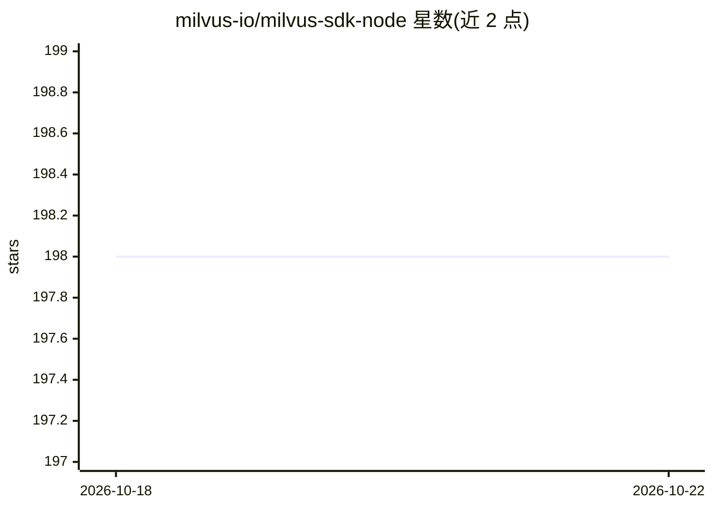

# milvus-io/milvus-sdk-node

⭐ 198 · TypeScript · Apache-2.0 · 推送 2026-10-15 · [GitHub](https://github.com/milvus-io/milvus-sdk-node) · [官网](https://milvus-io.github.io/milvus-sdk-node/) · 组织维护

**Milvus 向量数据库的官方 Node.js SDK**

由 Zilliz 维护的 Milvus 向量数据库官方 Node.js 客户端，提供 gRPC 与 HTTP 两种客户端。功能覆盖向量相似度搜索、混合搜索（Weighted/RRF 重排）、标量过滤查询、insert/upsert/delete 数据操作、集合/索引/分区/数据库/别名/资源组管理、用户与角色 RBAC、BulkWriter 离线导入与服务端批量导入、稀疏向量与 BM25 全文检索支持等。要求 Node.js v18+，SDK 版本与 Milvus 服务端版本有对应兼容矩阵；HTTP 客户端适配 Cloudflare Workers、Vercel Edge、AWS Lambda 等无法使用 gRPC 的环境。

## 筛选速览

| 维度 | 判定 | 备注 |
|---|---|---|
| AI 角色 | `ai-ecosystem` | LLM/agent 周边工具 |
| 许可风险 | `permissive` | Apache-2.0 |
| 部署形态 | `library` | 以包/库形式分发 |
| 模型依赖 | — | README 未给出锁定关系 |
| 硬件要求 | — | 无带数字的原话,不猜 |
| 安装摩擦 | `low` | 无编译、无系统依赖或容器化 |
| 成熟度 | — | 结构信号不足 |

## 能力要点

- gRPC 与 HTTP 双客户端，支持 Serverless 边缘环境接入
- 向量搜索、混合搜索（多向量字段+重排）与标量过滤查询
- 覆盖集合/索引/分区/数据库/RBAC/别名等完整管理操作
- BulkWriter 离线生成导入文件与服务端批量导入

## 适用场景

- Node.js 应用中接入 Milvus 做向量相似度搜索
- 在 Cloudflare Workers / Vercel Edge 等无 gRPC 环境通过 HTTP 客户端访问 Milvus
- 以代码管理 Milvus 集合 schema、索引、分区与用户权限
- 构建 BM25 全文检索与混合检索场景

## 场景标签

 · 领域:向量数据库/数据基础设施

## 证据(README 行号)

> L3: Official Node.js SDK for Milvus vector database. Provides gRPC and HTTP clients for vector similarity search, metada
> L5: **Package**: `@zilliz/milvus2-sdk-node` | **Node.js**: v18+ | **License**: Apache-2.0

## 星数曲线

2026-10-18 198 → 2026-10-22 198（+0）

---
*卡片 v1 · prompt 1.4 · 生成 2026-10-22 · 置信度 high · 依据 README sha `ec44de983fa8` · [字段定义](../../DATASET.md)*
