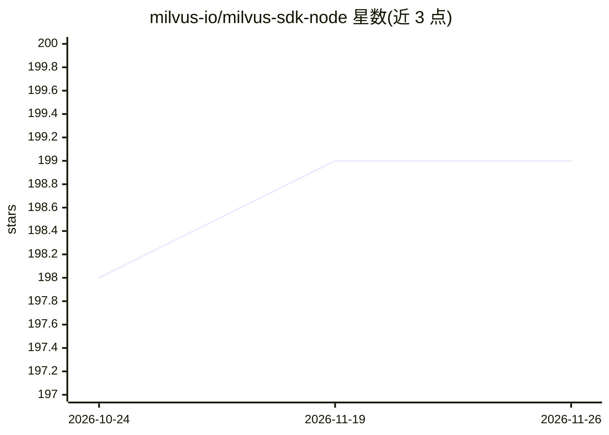

# milvus-io/milvus-sdk-node

⭐ 199 · TypeScript · Apache-2.0 · 推送 2026-11-24 · [GitHub](https://github.com/milvus-io/milvus-sdk-node) · [官网](https://milvus-io.github.io/milvus-sdk-node/) · 组织维护

**Milvus 向量数据库的官方 Node.js SDK 客户端**

面向 Node.js 开发者连接 Milvus 向量数据库的官方 SDK，提供 gRPC 与 HTTP 两种客户端。API 覆盖向量相似检索、标量过滤查询、多向量混合检索（带 RRF 重排）、集合/索引/分区/数据库/用户 RBAC/别名/资源组管理、批量导入、flush 与 compaction、健康检查等系统操作。要求 Node.js v18+，按 Milvus 服务端版本提供对应 SDK 版本线（v2.4.9 至 3.0.x），npm/yarn 安装。

## 筛选速览

| 维度 | 判定 | 备注 |
|---|---|---|
| AI 角色 | `ai-ecosystem` | LLM/agent 周边工具 |
| 许可风险 | `permissive` | Apache-2.0 |
| 部署形态 | `library` | 以包/库形式分发 |
| 模型依赖 | — | README 未给出锁定关系 |
| 硬件要求 | — | 无带数字的原话,不猜 |
| 安装摩擦 | `low` | 无编译、无系统依赖或容器化 |
| 成熟度 | — | 结构信号不足 |

## 能力要点

- 提供 MilvusClient（gRPC）与 HttpClient（REST v2）两种客户端
- 支持多向量 hybridSearch 与 RRF 重排、async iterator 分页检索
- 覆盖集合/索引/分区/数据库/RBAC/别名/资源组全量管理 API
- 支持 5 种向量类型（Float/Binary/Float16/BFloat16/Sparse）与 BM25 指标

## 适用场景

- 在 Node.js 服务端为应用接入 Milvus 向量检索
- 为 RAG 系统读写向量与标量混合数据
- 通过脚本管理 Milvus 集合、索引与用户权限

## 场景标签

`向量数据库` · 领域:知识与检索

## 证据(README 行号)

> L3: Official Node.js SDK for Milvus vector database. Provides gRPC and HTTP clients for vector similarity search, metada
> L5: **Package**: `@zilliz/milvus2-sdk-node` | **Node.js**: v18+ | **License**: Apache-2.0
> L118: #### search

## 星数曲线

2026-10-24 198 → 2026-11-26 199（+1）

---
*卡片 v1 · prompt 1.4 · 生成 2026-11-25 · 置信度 high · 依据 README sha `2c356db2a218` · [字段定义](../../DATASET.md)*
