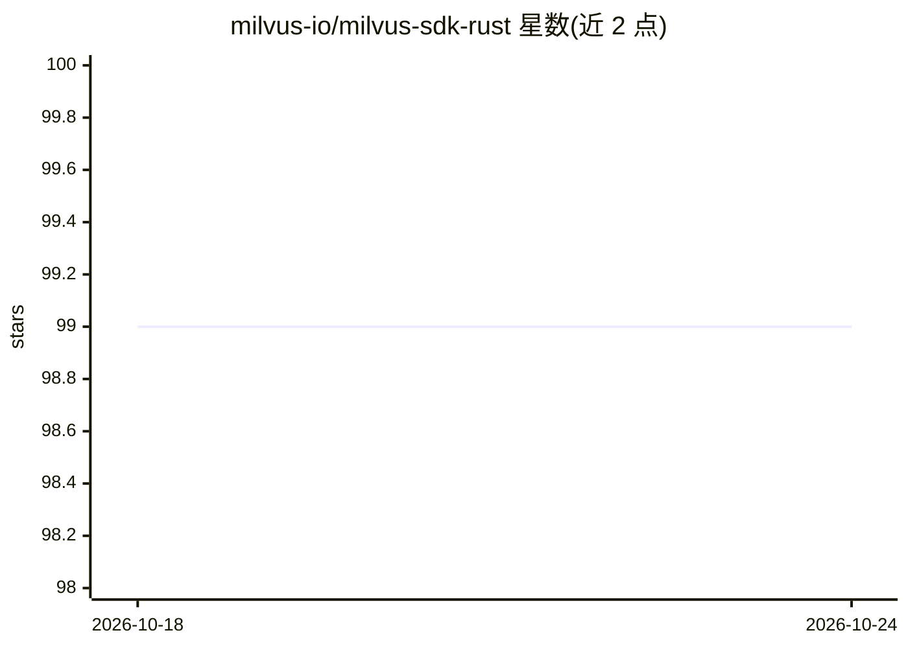

# milvus-io/milvus-sdk-rust

⭐ 99 · Rust · Apache-2.0 · 推送 2026-10-23 · [GitHub](https://github.com/milvus-io/milvus-sdk-rust) · 组织维护

**给 Rust 开发者的 Milvus 向量数据库官方 SDK**

Milvus 官方 Rust SDK，3.x 版本线对应 Milvus 3.x 服务端，MSRV 为 Rust 1.86。提供新版 ClientV2 请求/响应式 API，旧 Client API 保留维护模式。通过 cargo 依赖引入，配合 Tokio 运行时连接 Milvus（默认 localhost:19530，可用 MILVUS_URI/MILVUS_TOKEN 配置），覆盖集合创建、插入、加载、搜索等操作。附 8 个独立 Cargo 教程项目与 V1/V2 示例，支持可选 tracing 诊断特性，默认关闭且不记录凭据与向量数据。Apache 2.0 许可。

## 筛选速览

| 维度 | 判定 | 备注 |
|---|---|---|
| AI 角色 | `ai-ecosystem` | LLM/agent 周边工具 |
| 许可风险 | `permissive` | Apache-2.0 |
| 部署形态 | `None` |  |
| 模型依赖 | — | README 未给出锁定关系 |
| 硬件要求 | — | 无带数字的原话,不猜 |
| 安装摩擦 | `low` | 无编译、无系统依赖或容器化 |
| 成熟度 | — | 结构信号不足 |

## 能力要点

- ClientV2 请求/响应式 API，旧 Client API 保留维护模式
- 8 个从入门到进阶的独立 Cargo 教程项目（含 RBAC、Database）
- 可选 tracing 特性用于 SDK 诊断，默认不记录凭据与向量数据
- 通过 MILVUS_URI / MILVUS_TOKEN 环境变量配置连接与认证

## 适用场景

- 在 Rust 应用中连接并操作 Milvus 向量数据库
- 按教程路径学习集合、Schema、索引与 DML/DQL 操作
- 在 Rust 项目里接入向量检索能力（需另行部署 Milvus 服务端）

## 场景标签

`向量数据库` · 领域:知识与检索

## 证据(README 行号)

> L3: The official Rust SDK for Milvus.
> L16: New applications should use `ClientV2`, which provides the current request/response-style API.

## 星数曲线

2026-10-18 99 → 2026-10-24 99（+0）

---
*卡片 v1 · prompt 1.4 · 生成 2026-10-23 · 置信度 high · 依据 README sha `207e347d62d0` · [字段定义](../../DATASET.md)*
