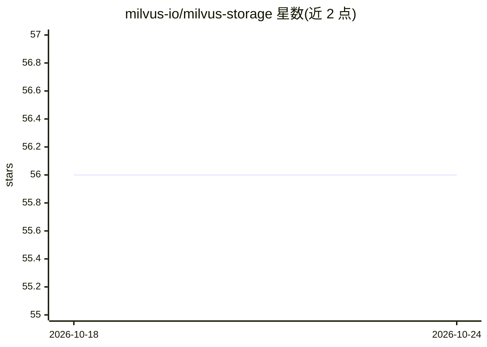

# milvus-io/milvus-storage

⭐ 56 · C++ · Apache-2.0 · 推送 2026-10-23 · [GitHub](https://github.com/milvus-io/milvus-storage) · 组织维护

**面向向量数据库的列式存储引擎，基于 Apache Arrow**

Milvus 生态的 C++ 列式存储引擎，服务于向量数据库与分析型负载。支持列组存储、Parquet/Vortex/Lance 多格式、ACID 类事务（manifest 版本与冲突解决）、静态数据加密与可配置压缩。内置对接多家云对象存储（AWS S3 及兼容、GCS、Azure Blob、阿里云 OSS、腾讯 COS、华为 OBS），提供 Python、Java/Scala、Rust、C++ 多语言绑定。构建需 CMake 3.20+、C++20 编译器与 Conan 2.0，从源码编译，无独立安装包。

## 筛选速览

| 维度 | 判定 | 备注 |
|---|---|---|
| AI 角色 | `ai-ecosystem` | LLM/agent 周边工具 |
| 许可风险 | `permissive` | Apache-2.0 |
| 部署形态 | `None` |  |
| 模型依赖 | — | README 未给出锁定关系 |
| 硬件要求 | — | 无带数字的原话,不猜 |
| 安装摩擦 | `medium` | 含编译或系统依赖之一 |
| 成熟度 | — | 结构信号不足 |

## 能力要点

- 基于 Apache Arrow 的列式存储引擎，列组组织优化 I/O 与压缩
- 支持 Parquet（主）、Vortex、Lance 三种文件格式
- manifest 版本化与冲突解决的 ACID 类事务语义
- 内置支持 AWS S3/GCS/Azure/阿里云 OSS/腾讯 COS/华为 OBS
- Python、Java/Scala、Rust、C++ 多语言 SDK 绑定

## 适用场景

- 为向量数据库提供底层列式文件存储层
- 在多云对象存储上运行分析型工作负载
- 需要事务语义与静态加密的湖仓式数据存储

## 场景标签

 · 领域:数据基础设施/存储引擎

## 证据(README 行号)

> L3: A high-performance columnar storage engine built on Apache Arrow, designed for vector databases and analytical workl
> L1: # Milvus Storage

## 星数曲线

2026-10-18 56 → 2026-10-24 56（+0）

---
*卡片 v1 · prompt 1.4 · 生成 2026-10-24 · 置信度 high · 依据 README sha `4d21e4853779` · [字段定义](../../DATASET.md)*
