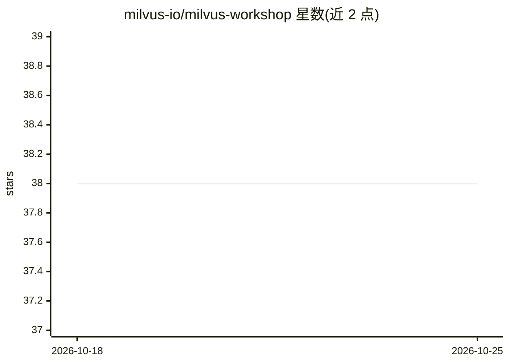

# milvus-io/milvus-workshop

⭐ 38 · Jupyter Notebook · Apache-2.0 · 推送 2026-08-28 · [GitHub](https://github.com/milvus-io/milvus-workshop) · 组织维护

**Milvus 向量数据库入门到应用的全流程实战工作坊教程**

面向初学者的 Milvus 实战教程：覆盖向量数据库概念、Docker Compose 与 Zilliz Cloud 安装部署、核心架构（Proxy/Coordinator/各 Node）与 RBAC、Python SDK 操作（Collection、数据插入、索引、向量/混合检索），以及图像搜索、RAG、AI Agent 三个应用案例；进阶部分含 Prometheus/Loki/Jaeger/Grafana 可观测性、VectorDBBench 基准测试、性能调优与 2.5→2.6 升级。学员需提前准备 Docker、Python 3.9+、pymilvus 等环境。

## 筛选速览

| 维度 | 判定 | 备注 |
|---|---|---|
| AI 角色 | `ai-knowledge` | 知识聚合/清单类 |
| 许可风险 | `permissive` | Apache-2.0 |
| 部署形态 | `self-host` | docker 或自建部署 |
| 模型依赖 | — | README 未给出锁定关系 |
| 硬件要求 | — | 无带数字的原话,不猜 |
| 安装摩擦 | `low` | 无编译、无系统依赖或容器化 |
| 成熟度 | — | 结构信号不足 |

## 能力要点

- 分四部分：安装与概念 → Python SDK 基本操作 → 图像搜索/RAG/Agent 应用 → 可观测性与性能调优
- 覆盖 FLAT/IVF/HNSW 等索引类型与向量搜索、标量过滤、Sparse-BM25 混合检索
- 含动手练习环节与 Zilliz Cloud 免费层实操
- 介绍 Milvus 生态工具（VTS、CDC、Backup、VectorDBBench、DeepSearcher、MCP）

## 适用场景

- 系统学习 Milvus 从安装到生产调优的完整流程
- 上手用 Milvus 搭建图像搜索、RAG 或 AI Agent 应用
- 了解 Milvus 架构、RBAC 与监控运维实践

## 场景标签

`教程课程` · 领域:学习与行业

## 证据(README 行号)

> L7: **Workshop Objectives:**
> L11: * Practice the role and implementation of Milvus in practical applications like image search, RAG (Retrieval-Augmen
> L139: * **3.2 Applying Milvus in RAG (Retrieval-Augmented Generation)**

## 星数曲线

2026-10-18 38 → 2026-10-25 38（+0）

---
*卡片 v1 · prompt 1.4 · 生成 2026-10-25 · 置信度 mid · 依据 README sha `0a40adc7585a` · [字段定义](../../DATASET.md)*
