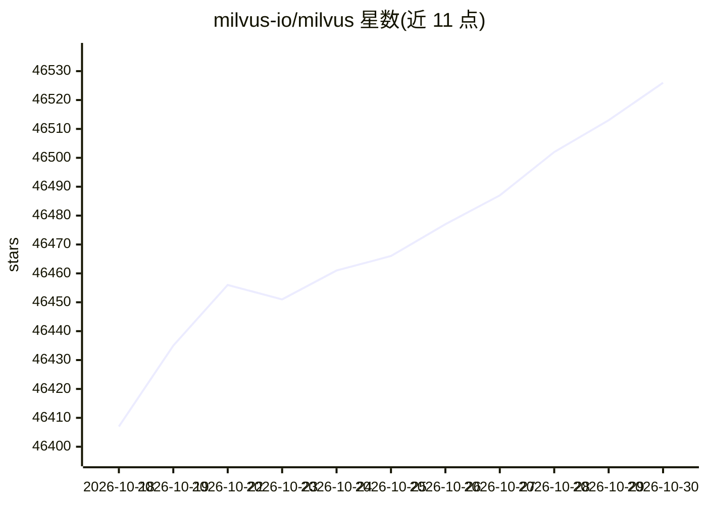

# milvus-io/milvus

⭐ 46,526 · Go · Apache-2.0 · 推送 2026-10-29 · [GitHub](https://github.com/milvus-io/milvus) · [官网](https://milvus.io) · 组织维护

**面向 AI 应用的分布式向量数据库：存储并检索大规模向量**

以 Go 和 C++ 编写的云原生向量数据库，存储向量与标量数据并支持向量 ANN 检索、元数据过滤与混合搜索。支持分布式（K8s 部署、计算存储分离）、单机 Standalone 与 Python pip 安装的 Milvus Lite 三种形态。索引类型覆盖 HNSW、IVF、FLAT、SCANN、DiskANN 及 GPU 索引（如 NVIDIA CAGRA），并原生支持 BM25 全文检索与 SPLADE/BGE-M3 稀疏向量。提供用户认证、TLS、RBAC 等企业特性，Apache 2.0 许可，隶属 LF AI & Data 基金会。

## 筛选速览

| 维度 | 判定 | 备注 |
|---|---|---|
| AI 角色 | `ai-ecosystem` | LLM/agent 周边工具 |
| 许可风险 | `permissive` | Apache-2.0 |
| 部署形态 | `library` | 以包/库形式分发 |
| 模型依赖 | — | README 未给出锁定关系 |
| 硬件要求 | — | 无带数字的原话,不猜 |
| 安装摩擦 | `medium` | 含编译或系统依赖之一 |
| 成熟度 | — | 结构信号不足 |

## 动量与使用信号

- 维护:`active` — 距上次 push 0.8 天,年发版 42,336 位贡献者
- 涨星:近 1 天 **+9**(自 20261016 起算)
- 安装:pypi 包 `pymilvus` 月下载 3,698,902

## 能力要点

- 支持 HNSW、IVF、DiskANN 等多种索引类型及 GPU 索引（CAGRA）
- 分布式架构支持水平扩展，并提供 Standalone 与 Milvus Lite 部署形态
- 原生支持 BM25 全文检索与 SPLADE/BGE-M3 稀疏向量的混合搜索
- 提供用户认证、TLS 加密与 RBAC 访问控制

## 适用场景

- 为 RAG 应用搭建向量检索后端
- 构建文本、图像语义搜索与推荐系统
- 企业场景下多租户向量数据管理与权限控制

## 场景标签

`向量数据库` · 领域:知识与检索

## 证据(README 行号)

> L16: 🐦 Milvus is a high-performance vector database built for scale. It powers AI applications by efficiently organizing
> L134:  Milvus integrates with a comprehensive suite of AI development tools, such as LangChain, LlamaIndex, OpenAI and H

## 星数曲线

2026-10-18 46,407 → 2026-10-30 46,526（+119）

---
*卡片 v1 · prompt 1.4 · 生成 2026-10-18 · 置信度 high · 依据 README sha `b58d32ac9246` · [字段定义](../../DATASET.md)*
