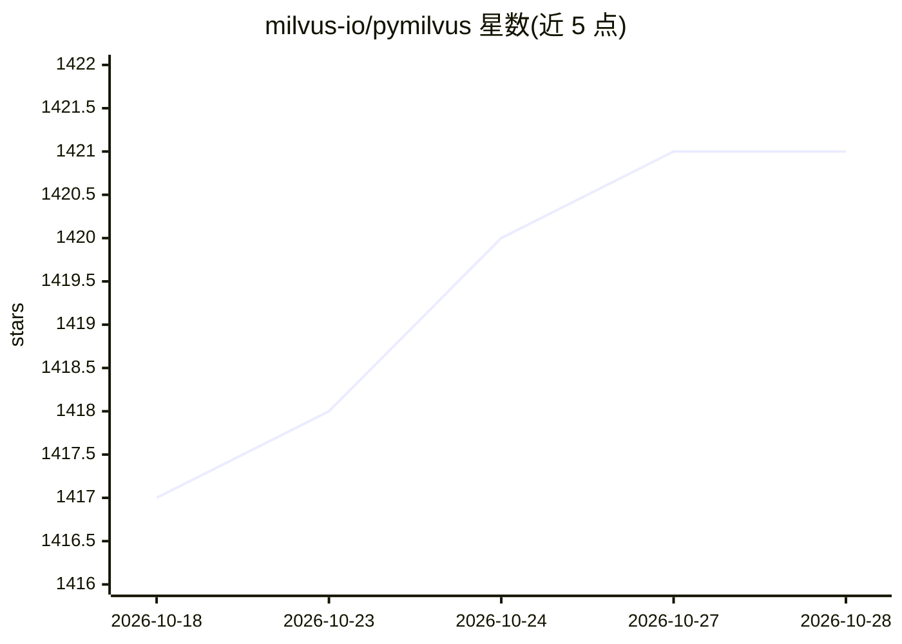

# milvus-io/pymilvus

⭐ 1,421 · Python · Apache-2.0 · 推送 2026-10-26 · [GitHub](https://github.com/milvus-io/pymilvus) · 组织维护

**Milvus 向量数据库的官方 Python SDK**

为 Milvus 向量数据库提供的 Python SDK，面向使用 Python 接入 Milvus 的开发者。支持 Python 3.9+，通过 pip 安装，提供 model、bulk_writer 等可选安装附加项。README 附带 Milvus 版本与推荐 PyMilvus 版本对照表（1.0 至 3.0），并说明基于 uv 的本地开发流程（proto 生成、lint、pre-commit、单元测试与 Milvus Lite 集成测试）。采用 Apache 2.0 许可证，由 Milvus 团队维护。

## 筛选速览

| 维度 | 判定 | 备注 |
|---|---|---|
| AI 角色 | `ai-ecosystem` | LLM/agent 周边工具 |
| 许可风险 | `permissive` | Apache-2.0 |
| 部署形态 | `library` | 以包/库形式分发 |
| 模型依赖 | — | README 未给出锁定关系 |
| 硬件要求 | — | 无带数字的原话,不猜 |
| 安装摩擦 | `medium` | 含编译或系统依赖之一 |
| 成熟度 | — | 结构信号不足 |

## 能力要点

- 覆盖 Milvus 1.0–3.0 各版本对应的 SDK 版本对照表
- pip 安装，提供 model / bulk_writer 可选组件
- 基于 uv + make 的本地开发与测试流程（含 Milvus Lite 集成测试）
- 开发分支自动打包发布到 Test PyPI

## 适用场景

- 在 Python 项目中连接和操作 Milvus 向量数据库
- 结合 milvus-model 做向量嵌入相关处理
- 参与 SDK 源码开发与测试

## 场景标签

`向量数据库` · 领域:知识与检索

## 证据(README 行号)

> L12: Python SDK for Milvus. To contribute code to this project, please read our contribution guidelines first. If you ha
> L32: You can install PyMilvus via `pip` or `pip3` for Python 3.9+:

## 星数曲线

2026-10-18 1,417 → 2026-10-28 1,421（+4）

---
*卡片 v1 · prompt 1.4 · 生成 2026-10-21 · 置信度 high · 依据 README sha `2d65008f6e78` · [字段定义](../../DATASET.md)*
