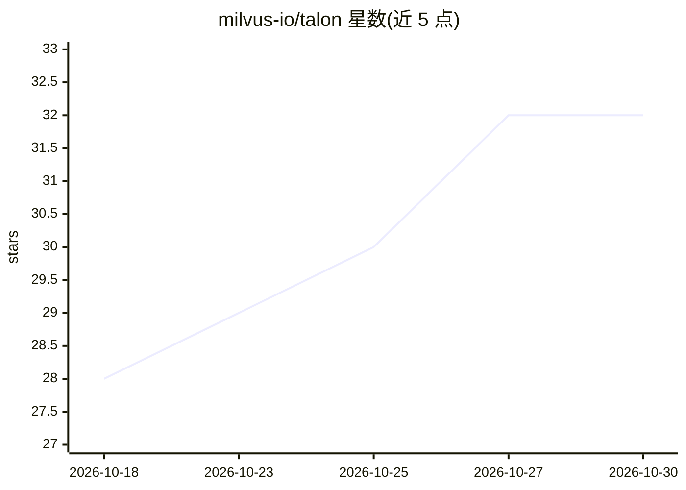

# milvus-io/talon

⭐ 32 · Rust · Apache-2.0 · 推送 2026-10-29 · [GitHub](https://github.com/milvus-io/talon) · 组织维护

**分布式 S3 对象存储缓存（Rust）：元数据不随数据增长**

用 Rust 编写的分布式对象存储缓存系统：命名空间、文件大小、目录结构均从对象存储自身的 key listing 派生，普通文件不占用元数据记录；协调器无状态、active-active 运行。读取采用零拷贝路径（sendfile/splice + io_uring）。可通过 FUSE 挂载或 Python/Java/C/Rust SDK 访问，支持预热（load/batch load）与 S3 429/503 重试。提供 Docker Compose、Helm 与源码构建三种安装方式，内置管理控制台。当前为 v0.1 pre-1.0，API 与磁盘布局可能变化；硬链接与 POSIX 锁定以报错方式拒绝。

## 筛选速览

| 维度 | 判定 | 备注 |
|---|---|---|
| AI 角色 | `ai-ecosystem` | LLM/agent 周边工具 |
| 许可风险 | `permissive` | Apache-2.0 |
| 部署形态 | `self-host` | docker 或自建部署 |
| 模型依赖 | — | README 未给出锁定关系 |
| 硬件要求 | — | 无带数字的原话,不猜 |
| 安装摩擦 | `low` | 无编译、无系统依赖或容器化 |
| 成熟度 | `idea` | |

## 能力要点

- 元数据从 S3 key listing 派生，普通文件零元数据记录
- 零拷贝读取路径（sendfile/splice，io_uring 驱动）
- FUSE 挂载与 Python/Java/C/Rust SDK 四种访问方式
- 支持按文件/批量的缓存预热与 S3 限流自动重试

## 适用场景

- 为模型训练与 checkpoint 读写加速 S3 数据访问
- notebook 环境以目录树形式挂载对象存储桶
- 跨云读取与数据分析场景的共享缓存
- Kubernetes 上部署 active-active 协调器的生产集群

## 场景标签

 · 领域:存储/缓存基础设施

## 证据(README 行号)

> L232: - **Deciding if Talon fits** — Use cases: model
> L234:  analytics — including where it does *not* help.

## 星数曲线

2026-10-18 28 → 2026-10-30 32（+4）

---
*卡片 v1 · prompt 1.4 · 生成 2026-10-26 · 置信度 mid · 依据 README sha `6f9fcc766e41` · [字段定义](../../DATASET.md)*
