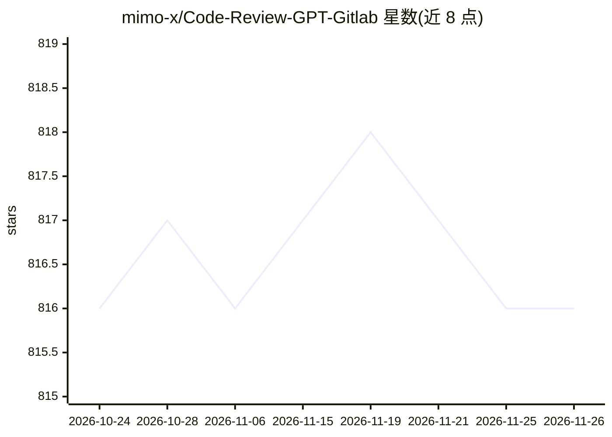

# mimo-x/Code-Review-GPT-Gitlab

⭐ 816 · Python · MIT · 推送 2026-11-16 · [GitHub](https://github.com/mimo-x/Code-Review-GPT-Gitlab) · [官网](https://mimo-x.github.io/Code-Review-GPT-Gitlab/) · 组织维护 · 中文 README

**面向研发团队的 GitLab LLM 辅助 Code Review 工具**

以 Webhook 方式接入 GitLab 的代码评审机器人：Merge Request 触发后由大模型生成评审意见，提供 Web 界面进行 Webhook 配置、Prompt 提示词配置、消息通知与评审详情查看。支持对接多种大模型（README 列举 GPT、DeepSeek 等）并可接入私有化 LLM，README 提到正在开发 Multi-Agent 插件使多个 Agent 协同评审，计划扩展支持 GitHub、Gitee、Bitbucket 等平台。部署提供 Docker Compose 与前后端源码运行两种方式。

## 筛选速览

| 维度 | 判定 | 备注 |
|---|---|---|
| AI 角色 | `ai-native` | 本体是模型或模型工具 |
| 许可风险 | `permissive` | MIT |
| 部署形态 | `self-host` | docker 或自建部署 |
| 模型依赖 | — | README 未给出锁定关系 |
| 硬件要求 | — | 无带数字的原话,不猜 |
| 安装摩擦 | `low` | 无编译、无系统依赖或容器化 |
| 成熟度 | — | 结构信号不足 |

## 能力要点

- 通过 GitLab Webhook 触发 Merge Request 的 LLM 代码评审
- Web 界面支持 Prompt 提示词配置与消息通知
- 支持对接多种大模型并可接入私有化 LLM
- 提供 Docker Compose 与源码两种部署方式

## 适用场景

- 给 GitLab 上的 Merge Request 自动生成评审意见
- 在研发流程中用提示词定制评审规则
- 接入私有化 LLM 在内网环境做代码安全评审

## 场景标签

`代码审查` · 领域:编码与开发

## 证据(README 行号)

> L13: > 一个利用大模型帮助我们在 Gitlab 上进行 Code Review 提升研发效能的项目 💪🏻 (( 包括但不限于 GPT 、DeepSeek 等🎁))
> L84: > 填写```Webhook URL```时，请在域名后添加路径```/api/webhook/gitlab/```，例如：```http://example.com/api/webhook/gitlab/```

## 星数曲线



2026-10-24 816 → 2026-11-26 816（+0）


---
*卡片 v1 · prompt 1.4 · 生成 2026-11-24 · 置信度 high · 依据 README sha `661ae718d400` · [字段定义](../../DATASET.md)*
