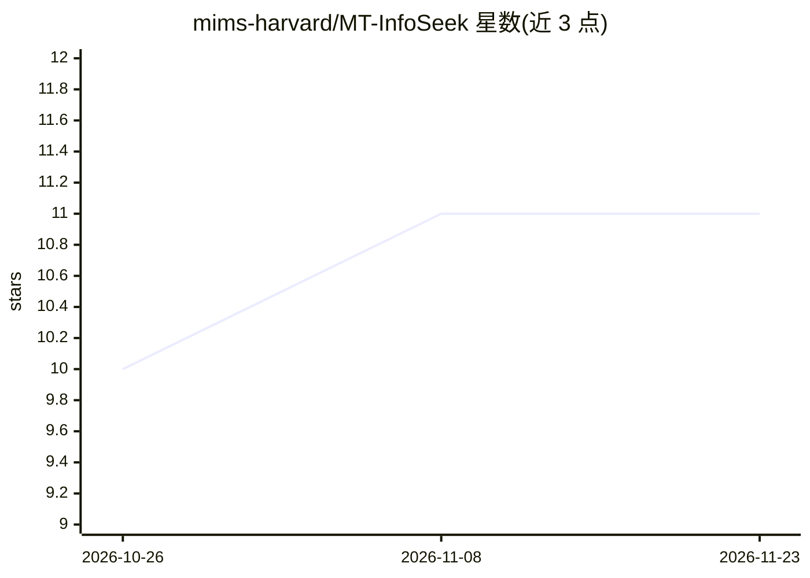

# mims-harvard/MT-InfoSeek

⭐ 11 · Python · NOASSERTION · 推送 2026-10-02 · [GitHub](https://github.com/mims-harvard/MT-InfoSeek) · [官网](http://zitniklab.hms.harvard.edu/MT-InfoSeek/) · 组织维护

**评测 LLM 多轮信息索取能力的基准：数据集+评测代码**

伴随论文《Do LLMs Know What to Ask and When?》发布的基准仓库，衡量模型在问题信息不完整时识别缺口、主动追问再求解的能力，覆盖逻辑、数学、生物、临床与常识五个领域。仓库含 data/ 基准文件、Croissant 机器可读元数据与 run_eval.py 一键评测驱动，支持 API 模型、vLLM 本地模型与 OpenAI 兼容端点，默认 smoke 分集，输出 summary.md/summary.json，可断点续跑；20Q 任务默认用 gpt-5-mini 作考官与离线裁判。

## 筛选速览

| 维度 | 判定 | 备注 |
|---|---|---|
| AI 角色 | `ai-ecosystem` | LLM/agent 周边工具 |
| 许可风险 | `none` | NOASSERTION |
| 部署形态 | `None` |  |
| 模型依赖 | local-ok | 支持本地模型 |
| 硬件要求 | — | 无带数字的原话,不猜 |
| 安装摩擦 | `low` | 无编译、无系统依赖或容器化 |
| 成熟度 | — | 结构信号不足 |

## 能力要点

- 五领域多轮信息索取评测（logic_q_mt/gsme_q_mt/genereg_mt/20q 四个自包含任务目录）
- 支持 API 模型与 vLLM 本地模型/自定义 OpenAI 兼容端点
- run_eval.py 一键驱动全套件，结果汇总为 summary.md/summary.json 并支持断点续跑
- 附 Croissant 机器可读数据元数据与各任务数据再生成流水线

## 适用场景

- 系统评测自家模型在信息不完整时主动提问的能力
- 按论文协议复现多轮信息索取基准结果
- 用 smoke 分集快速跑通评测流程后再扩展到全量数据

## 场景标签

`模型评测` · 领域:评测与运维

## 证据(README 行号)

> L10: This repository contains code and data for *Do LLMs Know What to Ask and When? Evaluating Multi-Turn Information Se
> L14: it, and then solve the task. MT-InfoSeek measures multi-turn information seeking across logical, mathematical, biol
> L113: ├── run_eval.py                    # one-command driver for the whole suite

## 星数曲线

2026-10-26 10 → 2026-11-23 11（+1）

---
*卡片 v1 · prompt 1.4 · 生成 2026-11-18 · 置信度 high · 依据 README sha `70efaa73c29f` · [字段定义](../../DATASET.md)*
