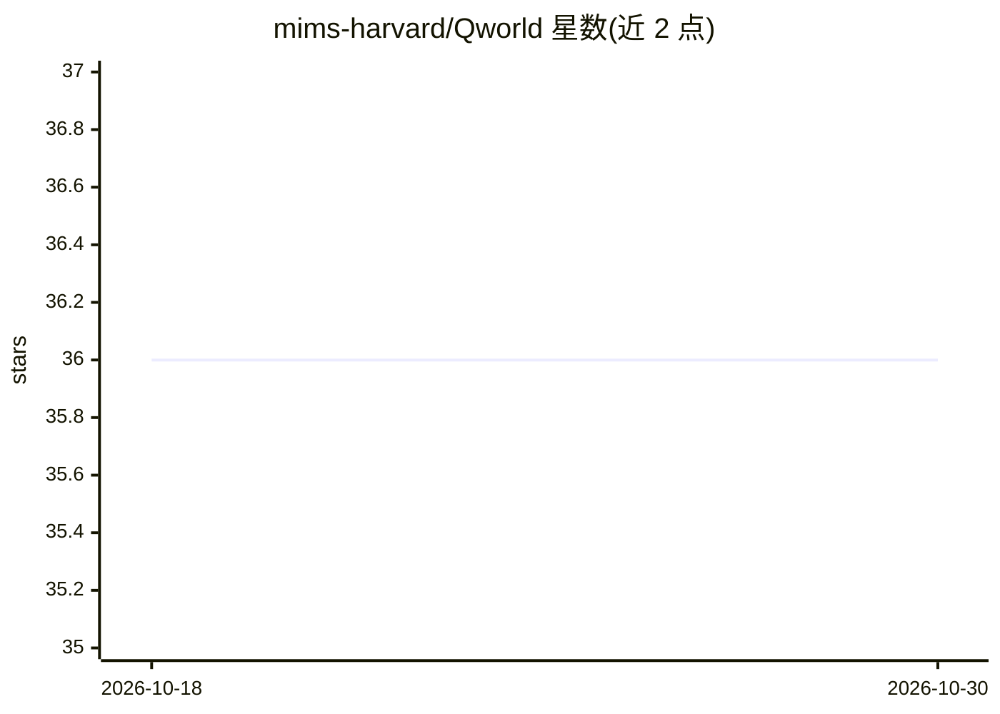

# mims-harvard/Qworld

⭐ 36 · Python · MIT · 推送 2026-08-17 · [GitHub](https://github.com/mims-harvard/Qworld) · [官网](https://qworld.openscientist.ai) · 组织维护

**为单个问题生成多维评估准则的 LLM 评测方法与库**

哈佛 MIMS 团队提出的 LLM 评测方法（COLM 2026）：给定一个问题，通过递归扩展树将其分解为场景、视角与细粒度二元准则，生成针对该问题的评估标准，替代数据集级静态评分表。以 Python 包 qworld 提供，支持 OpenAI/Azure/Claude/Gemini/Grok/DeepSeek/vLLM 等模型后端，嵌入向量用于准则去重（可选本地 sentence-transformers）。提供 Python API 批量生成（max_workers 并行）、交互式 Demo 与 HuggingFace 数据，可集成到 agentic 工作流。

## 筛选速览

| 维度 | 判定 | 备注 |
|---|---|---|
| AI 角色 | `ai-ecosystem` | LLM/agent 周边工具 |
| 许可风险 | `permissive` | MIT |
| 部署形态 | `library` | 以包/库形式分发 |
| 模型依赖 | local-ok | 支持本地模型 |
| 硬件要求 | — | 无带数字的原话,不猜 |
| 安装摩擦 | `low` | 无编译、无系统依赖或容器化 |
| 成熟度 | — | 结构信号不足 |

## 能力要点

- 递归扩展树将问题分解为场景/视角/细粒度二元准则
- 支持 OpenAI/Azure/Claude/Gemini/Grok/DeepSeek/vLLM 后端
- 批量生成 API，max_workers 并行处理整个数据集
- 嵌入去重（OpenAI/Azure/Gemini 或本地 sentence-transformers）

## 适用场景

- 为开放式问题的 LLM 回答生成针对性评分标准
- 批量生成整个数据集的评估准则并并行处理
- 在 agentic 工作流中以 plug-and-play 技能方式调用

## 场景标签

`模型评测` · 领域:评测与运维

## 证据(README 行号)

> L20: We introduce **One-Question-One-World (Qworld)**, a method that generates question-specific evaluation criteria usi
> L22: On HealthBench, Qworld covers 89% of expert-authored criteria and generates 79% novel criteria validated by human e

## 星数曲线

2026-10-18 36 → 2026-10-30 36（+0）

---
*卡片 v1 · prompt 1.4 · 生成 2026-10-25 · 置信度 high · 依据 README sha `3097feffa179` · [字段定义](../../DATASET.md)*
