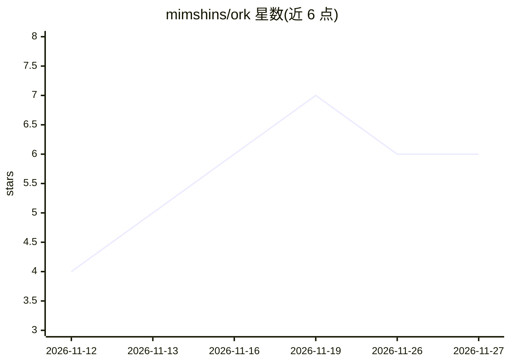

# mimshins/ork

⭐ 6 · TypeScript · MIT · 推送 2026-11-21 · [GitHub](https://github.com/mimshins/ork) · [官网](https://github.com/mimshins/ork/blob/main/docs/README.md) · 个人维护

**本地运行编码 Agent 工作流的编排框架**

在本地机器上运行编码 Agent 的编排工具：以纯 YAML 定义由 agent 节点与工具节点构成的分层工作流，保存在代码仓库旁并随 git 管理。每个写操作的 agent 在独立 git worktree 与分支上运行，Ork 不自动推送或合并；每节点可指定模型与 effort，支持预算与受限循环。Agent 节点以用户自己的登录运行 Claude Code、OpenCode、Command Code、Codex 或 omp 会话，一个工作流可混用多种。需 Node 24.20+、git 和至少一个 agent 驱动，经 npm 全局安装，提供终端与浏览器 UI。当前为 Alpha 版，格式与命令在 1.0.0 前可能变更。

## 筛选速览

| 维度 | 判定 | 备注 |
|---|---|---|
| AI 角色 | `ai-ecosystem` | LLM/agent 周边工具 |
| 许可风险 | `permissive` | MIT |
| 部署形态 | `library` | 以包/库形式分发 |
| 模型依赖 | — | README 未给出锁定关系 |
| 硬件要求 | — | 无带数字的原话,不猜 |
| 安装摩擦 | `low` | 无编译、无系统依赖或容器化 |
| 成熟度 | `idea` | |

## 能力要点

- 分层工作流：leader 向子节点下发简报并合并其分支
- 每个写 agent 独立 git worktree 与分支隔离运行
- 节点级模型/effort 配置、预算与受限循环
- 终端与浏览器（ork ui）两种运行界面

## 适用场景

- 把多 Agent 协作任务定义为可版本化的 YAML 工作流
- 在本地用自己账号并行运行多个编码 Agent
- 让 Agent 通过 MCP 客户端完成 Ork 安装与项目初始化

## 场景标签

`多智能体` `工作流自动化` `编码 Agent` · 领域:Agent 开发

## 证据(README 行号)

> L5: **An orchestration harness for coding agents (Claude Code, OpenCode, Command
> L10: Ork lets you design workflows of agent and tool nodes, save them as plain YAML
> L22: - **Your agent tools.** Each agent node runs a session of Claude Code, OpenCode,

## 星数曲线

2026-11-12 4 → 2026-11-27 6（+2）

---
*卡片 v1 · prompt 1.4 · 生成 2026-11-20 · 置信度 high · 依据 README sha `58d3a255cd61` · [字段定义](../../DATASET.md)*
