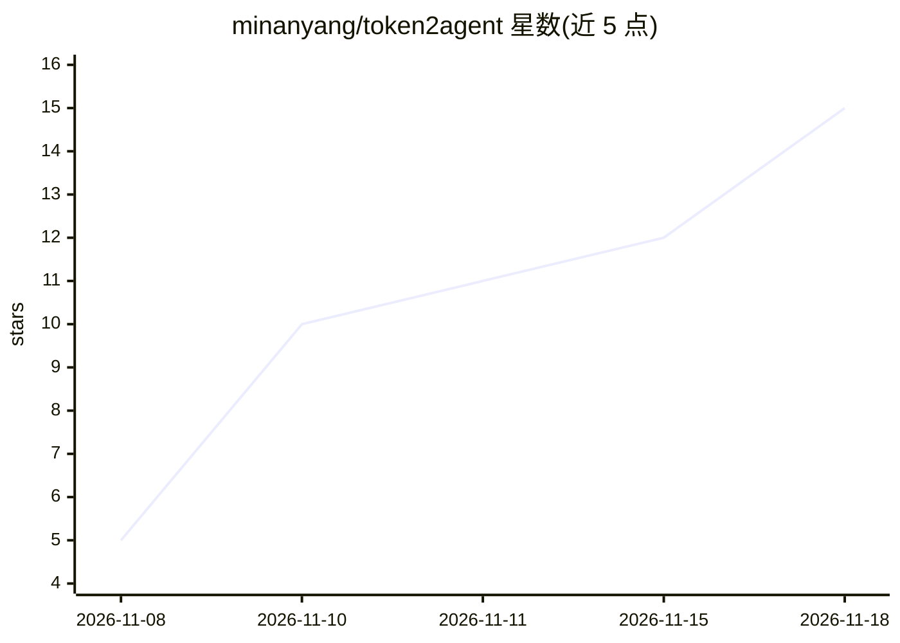

# minanyang/token2agent

⭐ 15 · JavaScript · NOASSERTION · 推送 2026-11-17 · [GitHub](https://github.com/minanyang/token2agent) · [官网](https://token2agent.com) · 个人维护 · 中文 README

**面向 AI/LLM 工程初学者的系统化学习路线图站点**

免费的中英（繁体）双语学习路线图，从 tokenization 讲到可评估、可上线安全的 agent 系统。内容含 20 章完整讲义、三条学习路线（应用路线无需 ML 背景、完整路线含模型原理、概念路线无编程）、每页 Simple/Deep 两种阅读模式、以规格形式给出的练习（不含答案）、贯穿章节的两个动手项目，以及 300+ 来源（含 24 门大学课程与 Anthropic/OpenAI/Google 工程指南）。通过网站 token2agent.com 阅读，无需安装。

## 筛选速览

| 维度 | 判定 | 备注 |
|---|---|---|
| AI 角色 | `ai-knowledge` | 知识聚合/清单类 |
| 许可风险 | `none` | NOASSERTION |
| 部署形态 | `None` |  |
| 模型依赖 | — | README 未给出锁定关系 |
| 硬件要求 | — | 无带数字的原话,不猜 |
| 安装摩擦 | `low` | 无编译、无系统依赖或容器化 |
| 成熟度 | — | 结构信号不足 |

## 能力要点

- 20 章、6 大部分（模型/应用/知识与工具/agents/生产/capstone）
- 三条路线：应用/完整/概念，适配不同背景读者
- 每页 Simple/Deep 双模式，练习以带数值验收标准的规格形式给出
- 基于 300+ 来源整理，全部来源在清单中标注日期

## 适用场景

- 作为初学者按顺序学习 AI/LLM 工程的路径
- 选择无需编程的路线理解 AI 系统概念
- 通过两个渐进式动手项目（AI 应用与小模型训练）练习

## 场景标签

`教程课程` · 领域:学习与行业

## 证据(README 行号)

> L11: Token2Agent is a free learning roadmap for AI/LLM engineering, in English and Traditional Chinese. It starts from h
> L25: - **20 chapters** with an introduction and six parts: models (optional), applications, knowledge and tools, agents,

## 星数曲线

2026-11-08 5 → 2026-11-18 15（+10）

---
*卡片 v1 · prompt 1.4 · 生成 2026-11-18 · 置信度 high · 依据 README sha `f722014c0876` · [字段定义](../../DATASET.md)*
