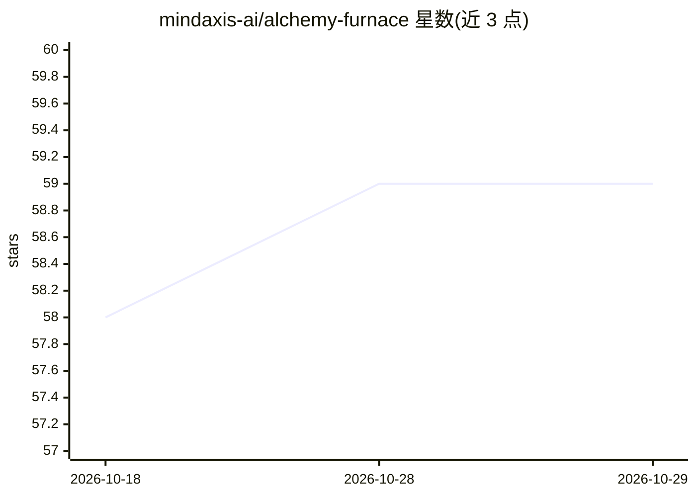

# mindaxis-ai/alchemy-furnace

⭐ 59 · Go · NOASSERTION · 推送 2026-10-08 · [GitHub](https://github.com/mindaxis-ai/alchemy-furnace) · 组织维护 · 中文 README

**打造 AI 人格并融合多性格的桌面对话工作台**

基于 Wails 的桌面应用，用于构建有辨识度的对话智能体：将语言风格、思维习惯等提炼为可复用的『金丹』，绑定到『道人』智能体上，通过权重与排序融合多个人格，支持一对一对话与多人圆桌。回复经四阶段编排（语义理解、确定性响应预算、人格化生成、Humanizer 润色），本地运行 Go 网关、Python 引擎与 Next.js UI，模型调用走 OpenAI 兼容端点，数据存 SQLite。提供 macOS/Windows 桌面包。

## 筛选速览

| 维度 | 判定 | 备注 |
|---|---|---|
| AI 角色 | `ai-native` | 本体是模型或模型工具 |
| 许可风险 | `none` | NOASSERTION |
| 部署形态 | `self-host` | docker 或自建部署 |
| 模型依赖 | — | README 未给出锁定关系 |
| 硬件要求 | — | 无带数字的原话,不猜 |
| 安装摩擦 | `low` | 无编译、无系统依赖或容器化 |
| 成熟度 | — | 结构信号不足 |

## 能力要点

- Elixir Pill/Dao Agent/Binding/Fusion 的人格结构化建模体系
- LangGraph 四阶段对话编排，含确定性校验（数字/URL/代码块/提示词泄漏）
- 本地 Go 网关 + Python FastAPI 引擎 + Next.js UI 的 Wails 架构
- macOS（arm64/amd64）与 Windows x64 桌面发布包

## 适用场景

- 创建具有稳定语言风格与个性的对话智能体
- 将多个人格融合并观察其协调与冲突的涌现表现
- 与单个智能体对话或组织多智能体圆桌讨论

## 场景标签

`聊天机器人` `多智能体` · 领域:Agent 开发

## 证据(README 行号)

> L27: - **Distil language patterns** — Turn a way of speaking, a skill tendency, or a personality trait into a structured
> L30: - **Talk and hold roundtables** — Develop a one-to-one relationship with an agent, or bring several together around
> L71: Alchemy Furnace is a **Wails desktop application**. It runs a Go gateway, Python language engine, and static Next.j

## 星数曲线

2026-10-18 58 → 2026-10-29 59（+1）

---
*卡片 v1 · prompt 1.4 · 生成 2026-10-24 · 置信度 mid · 依据 README sha `13c4c1cf59af` · [字段定义](../../DATASET.md)*
