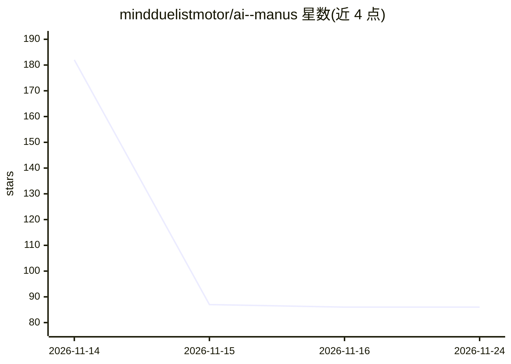

# mindduelistmotor/ai--manus

⭐ 86 · Apache-2.0 · 推送 2026-11-15 · [GitHub](https://github.com/mindduelistmotor/ai--manus) · 个人维护

**面向个人用户的自主 AI 代理，可执行代码并控制浏览器**

Manus 是一个自主 AI Agent 系统，在沙盒环境中运行各类工具与操作：自主编写并执行脚本、控制浏览器完成导航、填表与信息收集，并可在多步骤任务中串联代码与浏览器流程，面向家庭、学习与轻量办公场景的学生、远程工作者等非开发者用户。README 以功能介绍为主，给出系统兼容性表（最低双核 CPU / 4 GB 内存）与上手步骤，但未提供具体的安装命令、技术架构或模型接入说明，页面含 Download 与 PROMO2026 字样。

## 筛选速览

| 维度 | 判定 | 备注 |
|---|---|---|
| AI 角色 | `ai-native` | 本体是模型或模型工具 |
| 许可风险 | `permissive` | Apache-2.0 |
| 部署形态 | `None` |  |
| 模型依赖 | — | README 未给出锁定关系 |
| 硬件要求 | — | 无带数字的原话,不猜 |
| 安装摩擦 | `low` | 无编译、无系统依赖或容器化 |
| 成熟度 | — | 结构信号不足 |

## 能力要点

- 自主编写并执行代码完成任务
- 浏览器控制：导航网页、填写表单、收集信息
- 代码与浏览器操作在同一任务流中衔接
- 面向家庭/学习/轻量办公的小规模任务设计

## 适用场景

- 让学生整理研究资料、跑小脚本
- 让代理替我浏览多个网页并汇总信息
- 把重复性的日常小任务交给后台代理处理

## 场景标签

`浏览器自动化` `编码 Agent` `AI 助手` · 领域:效率与自动化

## 证据(README 行号)

> L10: - **Autonomous Code Execution:** Manus AI agent runs code on its own to complete tasks, so you can focus on decisio
> L18: Manus is an autonomous AI agent designed to run code and control a browser on your behalf. Instead of acting like a

## 星数曲线

2026-11-14 182 → 2026-11-24 86（-96）

---
*卡片 v1 · prompt 1.4 · 生成 2026-11-17 · 置信度 mid · 依据 README sha `637da4fbcded` · [字段定义](../../DATASET.md)*
