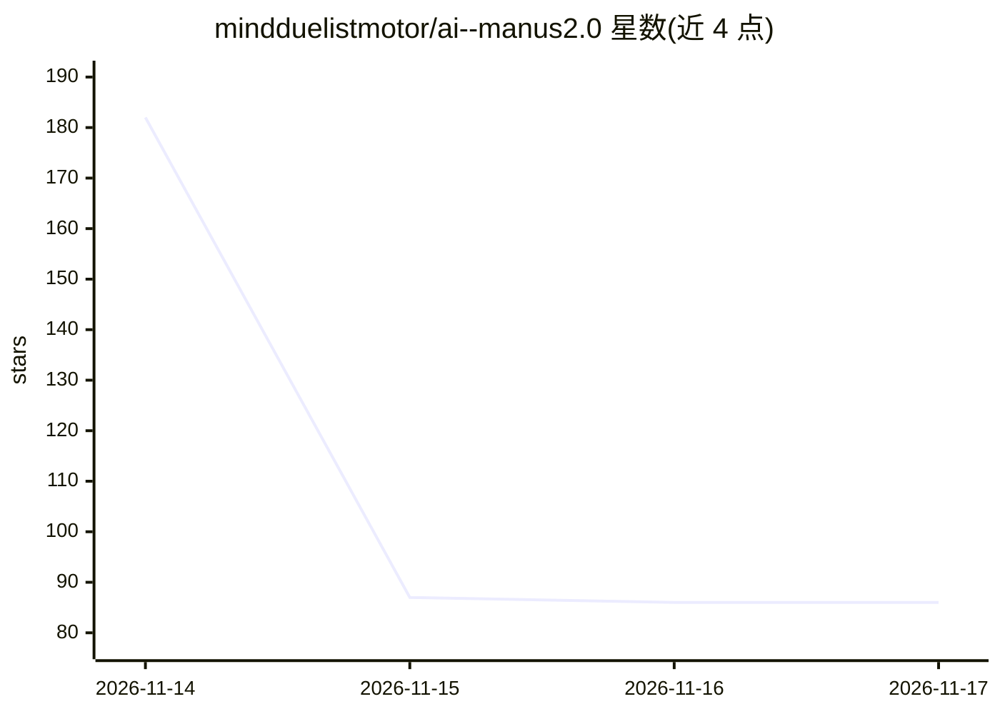

# mindduelistmotor/ai--manus2.0

⭐ 86 · Apache-2.0 · 推送 2026-11-15 · [GitHub](https://github.com/mindduelistmotor/ai--manus2.0) · 个人维护

**自主 AI Agent 系统：在沙箱中运行工具执行代码与浏览器操作**

README 以介绍性文案描述 Manus 为自主 AI agent：可自行编写并执行脚本、控制浏览器（导航、填表、采集信息）、执行多步骤任务，定位面向家庭、学习与轻量办公场景的非开发者用户。给出系统兼容性表格（双核 CPU / 4 GB RAM 起，推荐 8 GB）与上手步骤说明。README 未提供任何安装命令、代码示例或技术实现细节，功能陈述均以营销式描述呈现，无法从 README 验证其实现方式与模型接入途径。

## 筛选速览

| 维度 | 判定 | 备注 |
|---|---|---|
| AI 角色 | `ai-native` | 本体是模型或模型工具 |
| 许可风险 | `permissive` | Apache-2.0 |
| 部署形态 | `None` |  |
| 模型依赖 | — | README 未给出锁定关系 |
| 硬件要求 | — | 无带数字的原话,不猜 |
| 安装摩擦 | `low` | 无编译、无系统依赖或容器化 |
| 成熟度 | — | 结构信号不足 |

## 能力要点

- 自主执行代码与脚本完成多步骤任务
- 浏览器控制：导航网页、填写表单、采集信息
- 代码与浏览器操作在同一任务流中衔接
- 声明支持跨会话记忆工作流模式

## 适用场景

- 让 agent 代为执行重复性的代码运行与网页信息采集
- 学习与研究中组织笔记、收集参考资料
- 轻量办公中跨多页面汇总信息

## 场景标签

`浏览器自动化` `编码 Agent` `AI 助手` · 领域:效率与自动化

## 证据(README 行号)

> L10: - **Autonomous Code Execution:** Manus AI agent runs code on its own to complete tasks, so you can focus on decisio
> L18: Manus is an autonomous AI agent designed to run code and control a browser on your behalf. Instead of acting like a

## 星数曲线

2026-11-14 182 → 2026-11-17 86（-96）

---
*卡片 v1 · prompt 1.4 · 生成 2026-11-17 · 置信度 low · 依据 README sha `637da4fbcded` · [字段定义](../../DATASET.md)*
