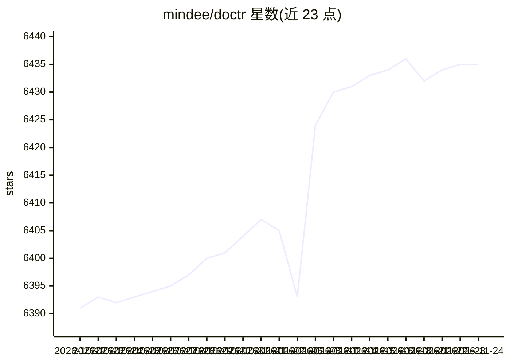

# mindee/doctr

⭐ 6,441 · Python · Apache-2.0 · 推送 2026-11-23 · [GitHub](https://github.com/mindee/doctr) · [官网](https://mindee.github.io/doctr/) · 组织维护

**面向开发者的深度学习 OCR 库：文档文字检测与识别**

基于 PyTorch 的 OCR 库，采用两阶段流程：文本检测定位文字区域，文本识别输出字符；读取 PDF 或图像后返回结构化 Document 对象，可导出 JSON 或重建文档。支持版面检测、旋转页面处理、KIE 多类别检测、表格结构识别与公式识别等预测器。由 Mindee 创建，现由 t2k GmbH 维护，提供商业服务；以 PyPI 包、源码安装与 Docker 镜像分发。

## 筛选速览

| 维度 | 判定 | 备注 |
|---|---|---|
| AI 角色 | `ai-native` | 本体是模型或模型工具 |
| 许可风险 | `permissive` | Apache-2.0 |
| 部署形态 | `self-host` | docker 或自建部署 |
| 模型依赖 | — | README 未给出锁定关系 |
| 硬件要求 | — | 无带数字的原话,不猜 |
| 安装摩擦 | `low` | 无编译、无系统依赖或容器化 |
| 成熟度 | — | 结构信号不足 |

## 能力要点

- 两阶段 OCR 流程：文本检测 + 文本识别，架构可自选
- 版面检测、表格结构识别、公式识别与 KIE 多类别预测器
- 提供 FastAPI 模板与 Hugging Face Spaces 在线演示
- GPU-ready Docker 镜像（CUDA 12.2）

## 适用场景

- 从 PDF 和扫描图像中提取文字与版面结构
- 构建文档解析 API 接入业务系统
- 识别表格结构与文档中的公式
- 处理含旋转页面的文档

## 场景标签

`OCR` · 领域:感知与多模态

## 证据(README 行号)

> L13: - efficient ways to parse textual information (localize and identify each word) from your documents
> L22: End-to-End OCR is achieved in docTR using a two-stage approach: text detection (localizing words), then text recogn

## 星数曲线

2026-10-22 6,391 → 2026-11-24 6,435（+44）

---
*卡片 v1 · prompt 1.4 · 生成 2026-11-24 · 置信度 high · 依据 README sha `c4d8a572edf2` · [字段定义](../../DATASET.md)*
