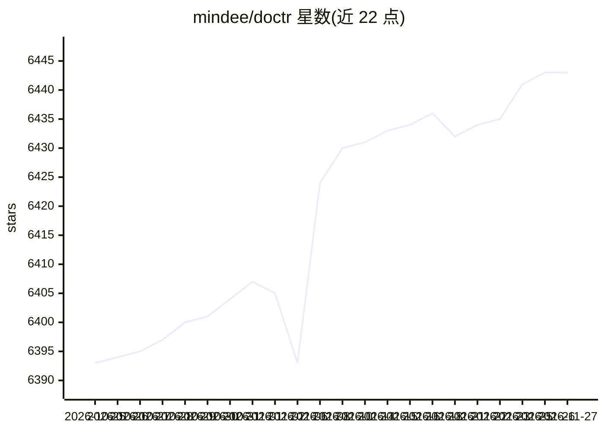

# mindee/doctr

⭐ 6,443 · Python · Apache-2.0 · 推送 2026-11-24 · [GitHub](https://github.com/mindee/doctr) · [官网](https://mindee.github.io/doctr/) · 组织维护

**开发者用深度学习 OCR 库：从文档图片/PDF 定位并识别文字**

docTR 是基于 PyTorch 的文档文字识别库，采用两阶段流水线（文本检测定位词、文本识别输出字符），支持 PDF 与图片输入。除基础 OCR 外还提供版面检测（Title/Text/Table 等区域）、表格结构重建、公式转 LaTeX、旋转页面处理、KIE 多类检测预测器，结果可导出 JSON 或重建文档。以 Python 包分发，附 FastAPI 服务模板、Streamlit demo、Jupyter notebooks 与 Docker 镜像；维护方为 t2k GmbH（原作者 Mindee），提供商业定制服务，Apache 2.0 许可。

## 筛选速览

| 维度 | 判定 | 备注 |
|---|---|---|
| AI 角色 | `ai-native` | 本体是模型或模型工具 |
| 许可风险 | `permissive` | Apache-2.0 |
| 部署形态 | `self-host` | docker 或自建部署 |
| 模型依赖 | — | README 未给出锁定关系 |
| 硬件要求 | — | 无带数字的原话,不猜 |
| 安装摩擦 | `low` | 无编译、无系统依赖或容器化 |
| 成熟度 | — | 结构信号不足 |

## 能力要点

- 两阶段 OCR 流水线，检测/识别架构可分别选择（DBNet、CRNN、PARSeq 等）
- 版面检测、表格结构识别与公式转 LaTeX 能力
- KIE 预测器支持多类目标检测（如日期、地址）
- 提供 GPU-ready Docker 镜像与 FastAPI 部署模板

## 适用场景

- 从扫描件或 PDF 中批量提取文字内容
- 解析文档版面结构、表格与公式
- 将 OCR 能力集成到自己的 API 服务中
- 处理含旋转页面的文档识别任务

## 场景标签

`OCR` `文档解析` · 领域:知识与检索

## 证据(README 行号)

> L3: **Optical Character Recognition made seamless & accessible to anyone, powered by PyTorch**
> L22: End-to-End OCR is achieved in docTR using a two-stage approach: text detection (localizing words), then text recogn

## 星数曲线

2026-10-25 6,393 → 2026-11-27 6,443（+50）

---
*卡片 v1 · prompt 1.4 · 生成 2026-11-26 · 置信度 high · 依据 README sha `2b28c989be47` · [字段定义](../../DATASET.md)*
