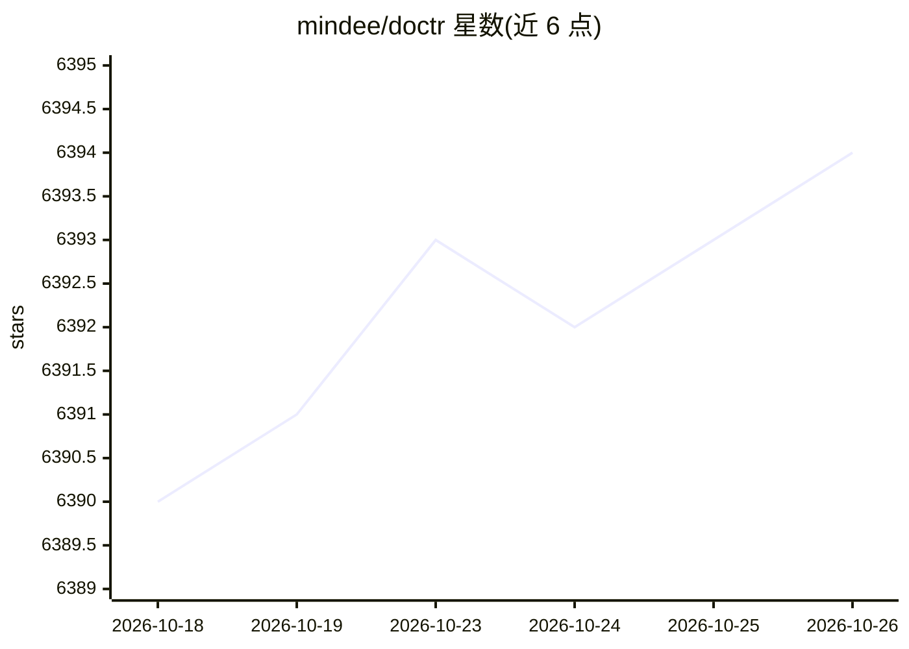

# mindee/doctr

⭐ 6,394 · Python · Apache-2.0 · 推送 2026-10-23 · [GitHub](https://github.com/mindee/doctr) · [官网](https://mindee.github.io/doctr/) · 组织维护

**深度学习 OCR 库：从 PDF/图像中定位并识别文档文字**

docTR 是基于深度学习的 Python OCR 库，由 Mindee 创建、t2k GmbH 维护。采用两阶段管线：文本检测（定位单词）+ 文本识别（识别字符），可选布局检测与 KIE（多类别检测+识别）预测器。支持 PDF 与图像输入，输出嵌套 Document 结构并可导出 JSON。实现 DBNet、FAST、CRNN、PARSeq 等多种已发表论文架构，基于 PyTorch/TensorFlow。需 Python 3.11+，经 pip 安装，另提供 Docker 镜像、Streamlit 演示、FastAPI 集成模板与示例脚本。

## 筛选速览

| 维度 | 判定 | 备注 |
|---|---|---|
| AI 角色 | `ai-native` | 本体是模型或模型工具 |
| 许可风险 | `permissive` | Apache-2.0 |
| 部署形态 | `self-host` | docker 或自建部署 |
| 模型依赖 | — | README 未给出锁定关系 |
| 硬件要求 | — | 无带数字的原话,不猜 |
| 安装摩擦 | `low` | 无编译、无系统依赖或容器化 |
| 成熟度 | — | 结构信号不足 |

## 能力要点

- 两阶段 OCR：检测+识别架构可独立选择
- 实现多种论文架构（DBNet、FAST、CRNN、PARSeq、ViTSTR 等）
- 布局检测（Title/Text/Table 等）与旋转文档处理选项
- KIE 预测器支持多类别检测（如仅检测日期与地址）
- 提供 Docker GPU 镜像（CUDA 12.2）与 FastAPI 部署模板

## 适用场景

- 从 PDF 或扫描图像中提取文本及位置信息
- 文档结构分析（标题/正文/表格区域识别）
- 按自定义类别（如日期、地址）做关键信息提取
- 通过 Docker 或 FastAPI 模板部署 OCR API

## 场景标签

`OCR` `文档解析` · 领域:知识与检索

## 证据(README 行号)

> L3: **Optical Character Recognition made seamless & accessible to anyone, powered by PyTorch**
> L22: End-to-End OCR is achieved in docTR using a two-stage approach: text detection (localizing words), then text recogn
> L28: model = ocr_predictor(det_arch="db_resnet50", reco_arch="crnn_vgg16_bn", pretrained=True)

## 星数曲线

2026-10-18 6,390 → 2026-10-26 6,394（+4）

---
*卡片 v1 · prompt 1.4 · 生成 2026-10-20 · 置信度 high · 依据 README sha `3508e420add1` · [字段定义](../../DATASET.md)*
