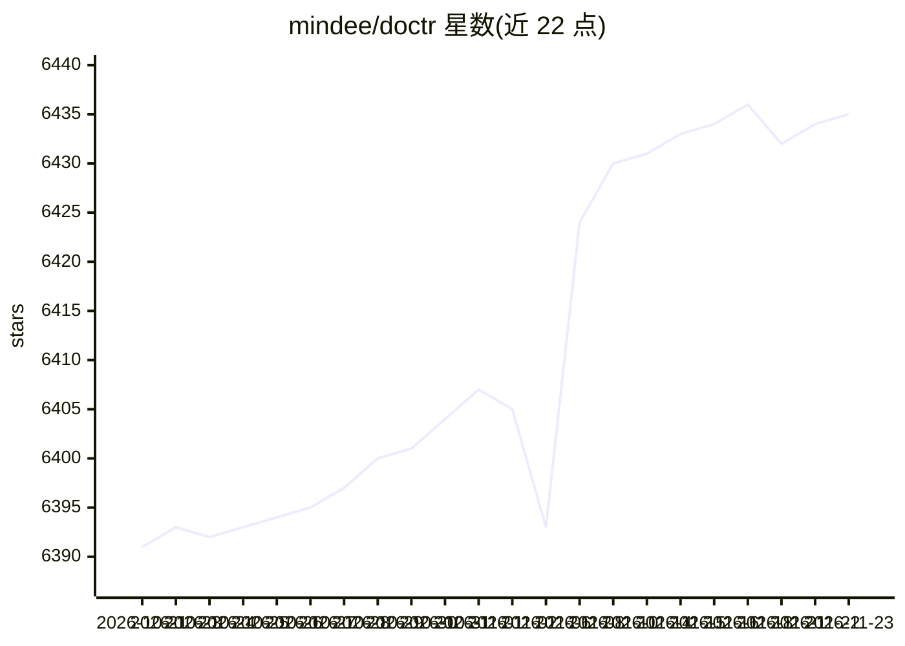

# mindee/doctr

⭐ 6,435 · Python · Apache-2.0 · 推送 2026-11-19 · [GitHub](https://github.com/mindee/doctr) · [官网](https://mindee.github.io/doctr/) · 组织维护

**面向开发者的深度学习 OCR 库：文档文字检测与识别**

基于 PyTorch 的 OCR 库，采用两阶段流程：先做文本检测定位词语，再做文本识别输出字符；读取 PDF 或图片，可附加版面检测（Title/Text/Table 等区域）、表格结构识别、公式识别与 KIE 多类检测预测器。结果以 Page/Block/Line/Word 嵌套结构返回，可导出 JSON 或可视化/重建页面。经 pip 安装，提供 Streamlit 本地 demo、Hugging Face Spaces 在线 demo、GPU-ready Docker 镜像及 FastAPI 模板（/detection /recognition /ocr /kie 路由）。维护方已由 Mindee 转为 t2k GmbH，后者围绕它提供商业服务。

## 筛选速览

| 维度 | 判定 | 备注 |
|---|---|---|
| AI 角色 | `ai-native` | 本体是模型或模型工具 |
| 许可风险 | `permissive` | Apache-2.0 |
| 部署形态 | `self-host` | docker 或自建部署 |
| 模型依赖 | — | README 未给出锁定关系 |
| 硬件要求 | — | 无带数字的原话,不猜 |
| 安装摩擦 | `low` | 无编译、无系统依赖或容器化 |
| 成熟度 | — | 结构信号不足 |

## 能力要点

- 两阶段 OCR 流程：文本检测 + 文本识别，架构可自选（DBNet、CRNN、PARSeq 等）
- 版面检测、表格结构识别、公式识别与 KIE 预测器管线
- 结果为嵌套文档结构，支持 JSON 导出与页面重建
- 提供 Docker 镜像、FastAPI 模板与 Hugging Face Spaces demo

## 适用场景

- 从 PDF 和扫描图片中提取文字与版面结构
- 对文档中的日期、地址等字段做多类检测识别
- 把 OCR 能力以 REST API 形式集成进自己的服务
- 处理含旋转页面的文档并可视化识别结果

## 场景标签

`OCR` `文档解析` · 领域:知识与检索

## 证据(README 行号)

> L22: End-to-End OCR is achieved in docTR using a two-stage approach: text detection (localizing words), then text recogn
> L28: model = ocr_predictor(det_arch="db_resnet50", reco_arch="crnn_vgg16_bn", pretrained=True)
> L7: **docTR** was originally created by Mindee. It is now actively developed and maintained by t2k GmbH.

## 星数曲线

2026-10-21 6,391 → 2026-11-23 6,435（+44）

---
*卡片 v1 · prompt 1.4 · 生成 2026-11-23 · 置信度 high · 依据 README sha `de9793d3ea30` · [字段定义](../../DATASET.md)*
