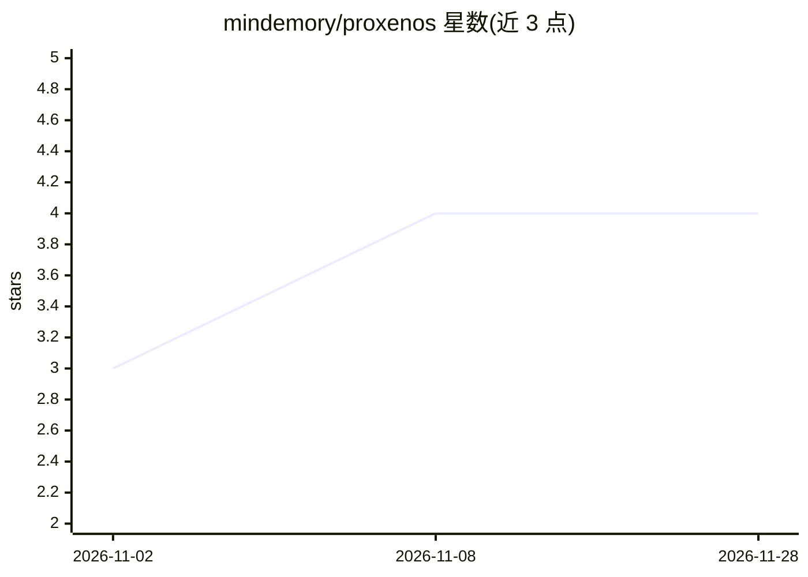

# mindemory/proxenos

⭐ 4 · Python · MIT · 推送 2026-11-22 · [GitHub](https://github.com/mindemory/proxenos) · [官网](https://mindemory.io/proxenos) · 个人维护

**本机私有的个人记忆工具：读你的记录并代拟下一步**

读取用户本机的邮件、聊天、日历、笔记、文档与健康记录，写入本地 vault，维护一份用户可读可改的文本自模型，并据此代拟回复、计划、通话稿、表格等，由用户确认后发送。默认本地模型运行，提示不出本机；可选接入 Claude/OpenAI/Gemini 托管模型。约 30 个数据源各自独立读取；草稿质量有盲评与评分机制。提供 macOS/Windows 桌面安装包与源码运行方式。

## 筛选速览

| 维度 | 判定 | 备注 |
|---|---|---|
| AI 角色 | `ai-native` | 本体是模型或模型工具 |
| 许可风险 | `permissive` | MIT |
| 部署形态 | `desktop` | 安装包/桌面程序 |
| 模型依赖 | local-ok | 支持本地模型 |
| 硬件要求 | — | 无带数字的原话,不猜 |
| 安装摩擦 | `low` | 无编译、无系统依赖或容器化 |
| 成熟度 | — | 结构信号不足 |

## 能力要点

- 读取约 30 类个人数据源（WhatsApp、Gmail、Apple Health 等）构建本地 vault
- 文本自模型可由用户阅读和更正，多个小 agent（clones）各司一职
- 本地模型默认：提示不出本机，托管模型调用前脱敏
- 草稿与实发内容对比评分，用户修改转化为写作规则

## 适用场景

- 就医流程中整理记录、准备预约简报和通话稿
- 在本地隐私前提下汇总多个通讯渠道并代拟回复
- 论文项目管理：进度综述、同行评审轮次、arXiv 打包

## 场景标签

`知识库管理` `AI 助手` · 领域:对话与助手

## 证据(README 行号)

> L17: Proxenos reads your own mail, chats, calendars, notes, documents and health records into a private vault on your co
> L47: **One model of you, in text you can read.** Observers read your side of each conversation, a month at a time, and w
> L53: **Local by default.** With a model on your computer, no prompt leaves it, apart from a call's audio. If you choose,

## 星数曲线

2026-11-02 3 → 2026-11-28 4（+1）

---
*卡片 v1 · prompt 1.4 · 生成 2026-11-21 · 置信度 high · 依据 README sha `e3ae71312b3a` · [字段定义](../../DATASET.md)*
