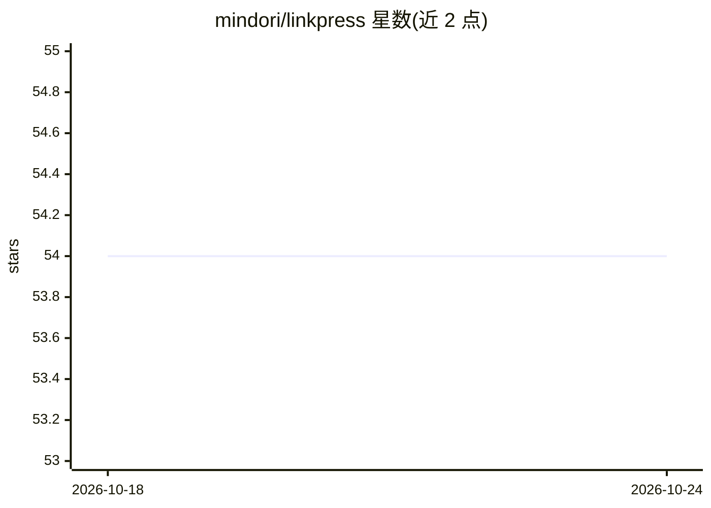

# mindori/linkpress

⭐ 54 · TypeScript · MIT · 推送 2026-02-01 · [GitHub](https://github.com/mindori/linkpress) · [官网](https://www.npmjs.com/package/linkpress) · 个人维护

**将 Slack 链接整理为带 AI 摘要的个人技术杂志**

TypeScript 编写的 CLI 工具：从用户连接的 Slack 频道与 Saved Messages 抓取链接，调用 AI 过滤非技术内容并生成每篇文章的标题、TL;DR、要点、难度分级与阅读时长，随后在本地生成杂志式 Web 界面（支持明暗主题、已读跟踪、watch 实时模式与多语言摘要）。目前 AI 提供商仅支持 Anthropic，OpenAI 与 Google 标注为 coming soon。数据 100% 本地存储，需 Node.js 18+ 与 AI API key。

## 筛选速览

| 维度 | 判定 | 备注 |
|---|---|---|
| AI 角色 | `ai-native` | 本体是模型或模型工具 |
| 许可风险 | `permissive` | MIT |
| 部署形态 | `library` | 以包/库形式分发 |
| 模型依赖 | locked-api |  |
| 硬件要求 | — | 无带数字的原话,不猜 |
| 安装摩擦 | `low` | 无编译、无系统依赖或容器化 |
| 成熟度 | — | 结构信号不足 |

## 能力要点

- 从 Slack 频道/Saved Messages 抓取链接并由 AI 过滤噪声
- 为每篇文章生成标题、TL;DR、要点、难度与阅读时长
- 本地杂志式 Web UI（明暗主题、已读跟踪、watch 实时模式）
- AI 摘要支持多语言（English/한국어/日本語/中文等）

## 适用场景

- 把 Slack 里堆积的技术文章链接整理成可读的杂志
- 在点击前通过 AI 摘要快速判断文章是否值得读
- 实时监控频道，新分享的文章自动出现在杂志里

## 场景标签

`AI 写作` `网页抓取` · 领域:效率与自动化

## 证据(README 行号)

> L19: **LinkPress fixes this.** It collects links from your Slack channels, uses AI to summarize them, and generates a be
> L21: - 🤖 **AI-Powered Summaries** — Get the gist before you click (Claude, GPT, or Gemini)

## 星数曲线

2026-10-18 54 → 2026-10-24 54（+0）

---
*卡片 v1 · prompt 1.4 · 生成 2026-10-24 · 置信度 high · 依据 README sha `b7627551845f` · [字段定义](../../DATASET.md)*
